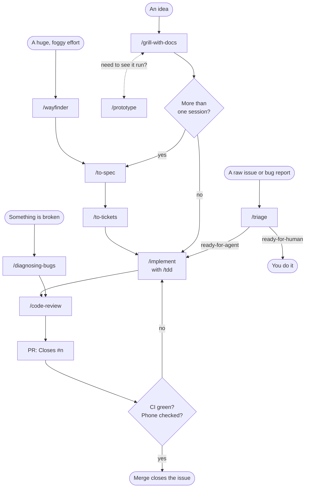

# Contributing

This page is the path from an idea to a merged pull request: which skill to use, in what order, and what it leaves behind.

The repository's engineering rules, area-specific guidance and required checks live in [CLAUDE.md](CLAUDE.md) and [the agent guides](docs/agents/). This page focuses on the workflow and GitHub conventions.

## The flow



Rounded boxes are where work starts. The table below says what each skill leaves behind.

## Which skill when

| You have | Use | It leaves behind |
| --- | --- | --- |
| A loose idea | `/grill-with-docs` | Sharper terms in `CONTEXT.md`, an ADR when a hard-to-reverse choice is made |
| An idea you can only judge by trying it | `/prototype` | Throwaway code, never merged |
| A grilled idea worth more than one session | `/to-spec`, then `/to-tickets` | A spec issue, then `ready-for-agent` sub-issues with blocked-by links |
| A small, grilled change | `/implement` | A branch with tests, reviewed by `/code-review` |
| Issues you didn't write (bugs, requests) | `/triage` | Labels, triage notes or an agent brief on the issue |
| A bug that resists a first look | `/diagnosing-bugs` | A fix with a regression test |
| A huge effort with no clear path | `/wayfinder` | A `wayfinder:map` issue whose tickets are decisions, handed to `/to-spec` when clear |
| A module that feels wrong | `/codebase-design` _auto_ | A smaller interface at a cleaner seam |
| A question to research | `/research` _auto_ | A cited Markdown note in the repo |

`/tdd`, `/grilling`, `/domain-modeling`, `/code-review` and `/writing-for-agents` are _auto_: the skills above call them, and Claude reaches for them when a task fits.

## Working habits

- **One goal per thread or session.** Grill, spec and tickets in one unbroken conversation; then each ticket starts fresh, because the ticket carries everything it needs.
- **Don't triage what `/to-tickets` made.** Those issues are born `ready-for-agent`.
- **Use the repository guidance.** Start with [CLAUDE.md](CLAUDE.md); it links to the glossary, architecture, decisions and area-specific rules.

## Labels

Every issue has one type, one state and at least one area, and sits in its phase's milestone. The labels are defined in [`.github/labels.yml`](.github/labels.yml) and synced to GitHub when that file changes on `main`.

| Group | Labels |
| --- | --- |
| Type | `bug`, `enhancement`, `documentation` |
| State | `needs-triage` → `needs-info`, `ready-for-agent`, `ready-for-human` or `wontfix` |
| Area | `area:shared`, `area:android`, `area:ios`, `area:devices`, `area:catalog`, `area:server`, `area:web`, `area:design` |
| Check | `device-test` |
| Wayfinder | `wayfinder:map`, `wayfinder:research`, `wayfinder:prototype`, `wayfinder:grilling`, `wayfinder:task` |

## Checks before a PR

Follow the required checks in [CLAUDE.md](CLAUDE.md). CI also lints Markdown, checks its links and verifies that every published page is reachable from the docs site's sidebar. To run the documentation checks locally (lychee is a separate install; see [its README](https://github.com/lycheeverse/lychee#installation)):

```sh
npx markdownlint-cli2
lychee --config lychee.toml './**/*.md'
(cd site && npm ci && npm run build && node check-published.mjs)
```
