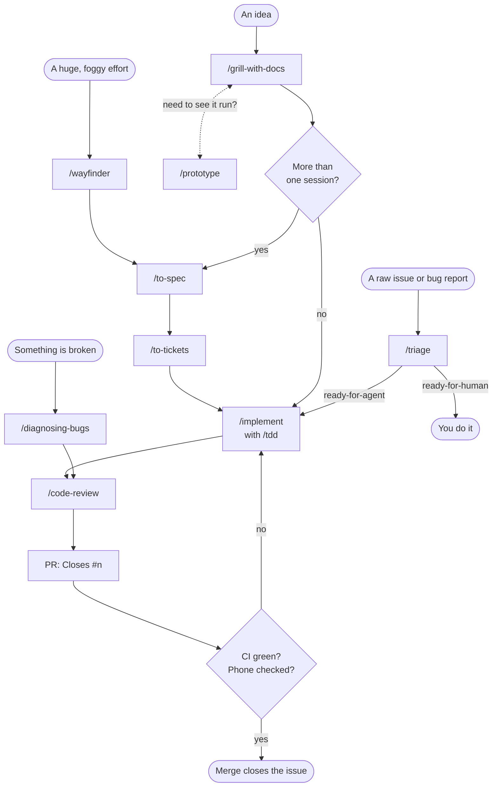

# Contributing

Coach Poulpy is built mostly by talking to Claude, using [Matt Pocock's engineering skills](https://github.com/mattpocock/skills). This page says which skill to reach for, in what order, and what each one leaves behind in the repo or on GitHub.

Everything below works the same in a Claude Code terminal (type `/triage`, `/to-spec`...) and in a Claude project thread (write "triage #12" or "run to-spec on this"). Skills marked _auto_ are picked up by Claude without being named.

## The flow



Rounded boxes are where work starts; each step leaves something behind, listed in the table below.

## Which skill when

| You have | Use | It leaves behind |
| --- | --- | --- |
| A loose idea | `/grill-with-docs` | Sharper terms in `CONTEXT.md`, an ADR when a hard-to-reverse choice is made |
| An idea you can only judge by trying it | `/prototype` | Throwaway code, never merged |
| A grilled idea worth more than one session | `/to-spec`, then `/to-tickets` | A spec issue, then `ready-for-agent` sub-issues with blocked-by links |
| A small, grilled change | `/implement` | A branch with tests, reviewed by `/code-review` |
| Issues you didn't write (bugs, requests) | `/triage` | Labels, triage notes or an agent brief on the issue |
| A bug that resists a first look | `/diagnosing-bugs` | A fix with a regression test |
| A huge effort with no clear path | `/wayfinder` | A `wayfinder:map` issue whose tickets are decisions, handed to `/to-spec` when clear |
| A module that feels wrong | `/codebase-design` _auto_ | A smaller interface at a cleaner seam |
| A question to research | `/research` _auto_ | A cited Markdown note in the repo |

`/tdd`, `/grilling`, `/domain-modeling`, `/code-review` and `/writing-for-agents` are _auto_: the skills above call them, and Claude reaches for them when a task fits.

## Habits that keep it working

- **One goal per thread or session.** Grill, spec and tickets in one unbroken conversation; then each ticket starts fresh, because the ticket carries everything it needs.
- **Don't triage what `/to-tickets` made.** Those issues are born `ready-for-agent`.
- **Ask the role that owns it.** The Architect, Designer, Poulpy keeper, Translator and Maintainer threads each own part of the repo; a spec asks them before its tickets exist, and a PR that touches their files sends them the link. See [`docs/agents/roles.md`](docs/agents/roles.md).
- **Words come from `CONTEXT.md`.** If an issue or a test needs a word the glossary lacks, add it there first.
- **A decision that would surprise the next reader gets an ADR** in `docs/adr/`, in the same PR that makes it.
- **Every PR says `Closes #n`**, so merging closes the issue.
- **Branch names say what the work is**: `<type>/<issue-number>-<short-description>`, in English, like `feat/21-training-plans` or `fix/34-rest-timer-sound`. Leave out the number when there is no issue (`docs/brand-decisions`). Types are `feat`, `fix`, `docs`, `chore` and `design`. No random suffixes, session ids or tool prefixes such as `claude/`.
- **Every guideline is on the docs site.** A new rule, glossary or ADR is published in the same PR that adds it: add its file to `site/published.mjs` and a sidebar entry in `site/.vitepress/config.mts`. CI fails on a Markdown file the site doesn't publish or a page no link reaches.
- **CI is not a phone.** Anything about Bluetooth, sound, haptics, background running or installs carries the `device-test` label and is checked on a real phone before merge.

## Labels

Every issue has one type, one state and at least one area, and sits in its phase's milestone. The labels are defined in [`.github/labels.yml`](.github/labels.yml) and synced to GitHub when that file changes on `main`.

| Group | Labels |
| --- | --- |
| Type | `bug`, `enhancement`, `documentation` |
| State | `needs-triage` → `needs-info`, `ready-for-agent`, `ready-for-human` or `wontfix` |
| Area | `area:shared`, `area:android`, `area:ios`, `area:devices`, `area:catalog`, `area:server`, `area:web`, `area:design` |
| Check | `device-test` |
| Wayfinder | `wayfinder:map`, `wayfinder:research`, `wayfinder:prototype`, `wayfinder:grilling`, `wayfinder:task` |

How agents read the tracker and the domain docs is in [`docs/agents/`](docs/agents/).

## Running and checking the code

See the [README](README.md) for building each app. Before opening a PR, at least run:

```sh
./gradlew jvmTest jsTest :server:test
node design/build-tokens.mjs --check
node design/build-poulpy.mjs --check
```

When a change touches Markdown, CI also lints it, checks its links and checks the site publishes it. To run the same checks first (lychee is a separate install, see [its README](https://github.com/lycheeverse/lychee#installation)):

```sh
npx markdownlint-cli2
lychee --config lychee.toml './**/*.md'
(cd site && npm ci && npm run build && node check-published.mjs)
```
