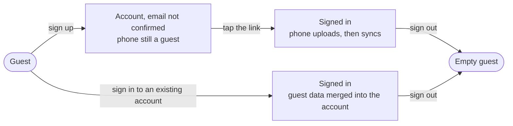

# Accounts

What a guest gets by signing up, and what the server and the phones do with an **account**. This is the spec for [#25](https://github.com/tkint/coach-poulpy/issues/25); the tickets built from it are its sub-issues. How a request is authenticated is in [The API](./the-api.md) and [ADR 0020](./adr/0020-every-credential-resolves-to-one-caller.md); the phone stays the source of truth ([ADR 0001](./adr/0001-local-first-phone-is-the-source-of-truth.md)).

## Signing up and signing in

- **Email and password only, for now.** Sign in with Apple and Google come later, each as one new authenticator; no route changes. Passwords are hashed with Argon2id.
- **The email is confirmed before any data leaves the phone.** Signing up sends a link; until it is tapped, the phone keeps working as a guest and uploads nothing. A typo in the address can never tie health data to someone else's mailbox.
- **Health data consent is asked at sign-up**, with a link to what is stored and why.
- **Forgotten password**: the person asks for a reset link by email and chooses a new password; every phone is signed out.
- **Mail goes out over plain SMTP** to an EU provider set in the server's settings, so the provider can change without a code change.

## The phone and the account

- **The first upload keeps every id** ([ADR 0005](./adr/0005-ids-are-uuidv7-made-on-the-device.md)).
- **Signing in on a phone that has guest data merges it** into the account. Ids never collide and sync keeps both edits ([ADR 0006](./adr/0006-sync-keeps-both-edits.md)), so nothing is lost or overwritten.
- **Signing out clears the phone once everything is uploaded.** If some changes can't be uploaded (no connection), the phone says so and lets the person wait or sign out anyway. The phone then starts again as an empty guest, so the next person on a shared phone sees nothing.

## What follows the account

| Follows the account | Stays on each phone |
| --- | --- |
| Workouts, plans, enrollments, sessions | Theme |
| Profile and body log | App icon |
| Units and language | Paired treadmills and other devices |

## Leaving

- **Deleting the account happens at once**, after the password: every row is deleted, every phone is signed out and goes back to a guest with its own copy, and the nightly dumps age out within 30 days.
- **Export** gives all the account's data as JSON, and sessions as FIT files.

## Screens

Drafted in [#272](https://github.com/tkint/coach-poulpy/issues/272); they sit under Mockups, Drafts, Accounts on the site and are built once the owner has agreed them ([ADR 0016](./adr/0016-mockups-are-plain-html-in-the-repo.md)).

- **Settings** gets an **Account** section at the top. A guest sees one row, "Sign in or create an account". With an unconfirmed email it reads "Confirm your email"; signed in it shows the address and the sync state. (`account-settings-guest`, `-pending`, `-synced`)
- **Sign up** asks for the email, a password (8 characters or more, with a show toggle) and the health data consent, whose link opens "What is stored". Errors sit under their field in `error` with an icon; an offline attempt says the app keeps working as a guest. (`account-sign-up`, `-error`, `-offline`, `-consent-sheet`)
- **Check your email** never says whether the address already had an account: the server answers the same either way, so the text is "If this address can get an account, a link is on its way". "Send the link again" signs up again with the same address. An expired or used link has its own page. (`account-check-email`, `-resent`, `account-link-expired`)
- **Email confirmed** and **Welcome back** (signing in on a phone that has guest data) show the upload as a progress card; nothing is replaced, both edits are kept. (`account-confirmed`, `account-sign-in-merge`)
- **Sign in** has "Forgot your password?", which sends a link; the link opens "Choose a new password", and every phone is signed out, so the next stop is Sign in with a "Password changed" note. A wrong email or password gives one message that doesn't say which. (`account-sign-in`, `-error`, `-reset-done`, `account-forgot-password`, `-sent`, `account-reset-password`)
- **The account page** shows the address, the sync state, what follows the account, Export my data, Sign out and Delete account; before the email is confirmed it offers the link again instead. (`account-details`, `-pending`)
- **Sign out** says the phone goes back to an empty guest. When changes aren't uploaded yet, a second dialog says they will never reach the account and offers "Wait for the upload" or "Sign out anyway". (`account-sign-out`, `-unsent`)
- **Delete account** is a sheet that says what goes, asks for the password and deletes at once; a wrong password says nothing was deleted. (`account-delete`, `-error`)

## Not yet

Apple and Google sign-in, the website's sign-in, sharing and coaching, and personal access tokens ([#228](https://github.com/tkint/coach-poulpy/issues/228)).
