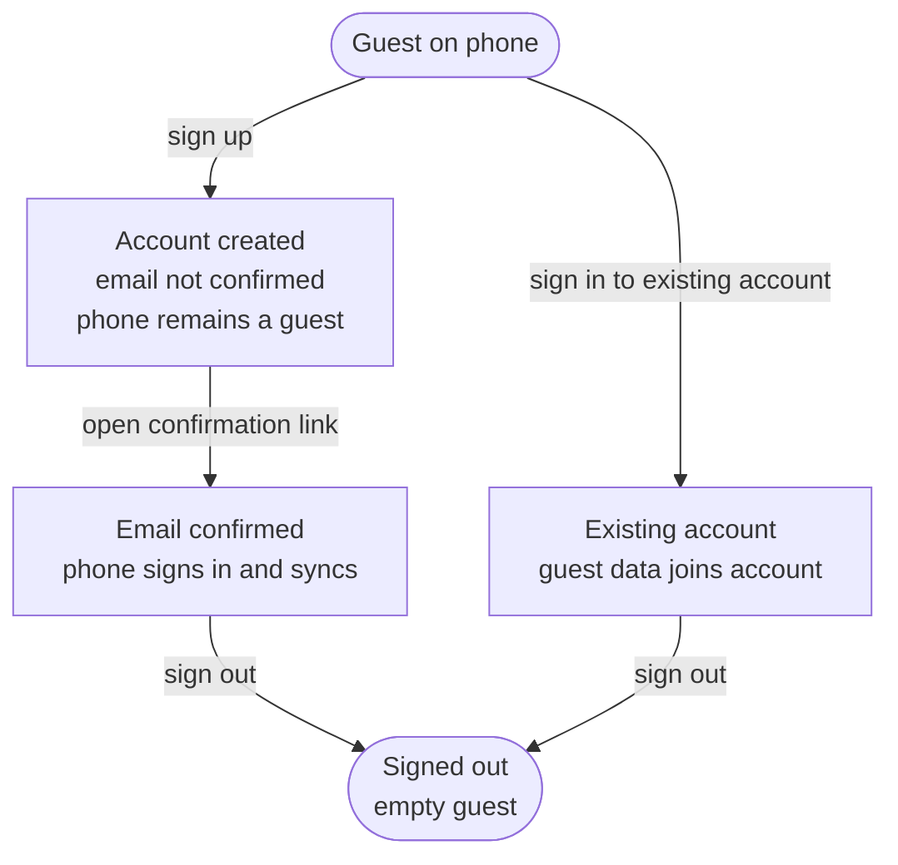

# Accounts

An account lets a guest keep their training across phones and use the website. Without one, everything stays on the phone, which is always the source of truth ([ADR 0001](./adr/0001-local-first-phone-is-the-source-of-truth.md)). This page holds the rules ([#25](https://github.com/tkint/coach-poulpy/issues/25)). How sign-in works underneath is in [The API](./the-api.md), and how phones exchange data is in [Sync](./sync.md).

## Signing up

A guest signs up in the app with an email and a password, and agrees to the health-data consent. Apple and Google sign-in don't exist yet.

Nothing leaves the phone until the email is confirmed. Until the person opens the link in the email, the phone stays a guest and uploads nothing.

The link works on the phone or on any other device. If it opens elsewhere, the waiting phone notices and signs itself in. The confirmation sheet waits until a guided session or Live recording ends before it appears ([#319](https://github.com/tkint/coach-poulpy/issues/319)).

A person waiting for the link can ask for it again, or start over with another address. The old address stays unconfirmed.

## Signing in

Sign-in uses the email and password. After five failed tries in 15 minutes, sign-in pauses for a while.

**Coach Poulpy never reveals whether an email has an account.** An unknown address and a wrong password get the same refusal. Signing up with an address that already has an account, or asking a reset for an address without one, looks exactly like a success.

A phone stays signed in until the person signs out, resets the password, deletes the account or someone revokes that sign-in. Then it becomes a guest again and keeps its data.

## Forgotten password

The person asks for a reset link by email and picks a new password. The link lasts one hour and works once. At most three links go out per hour.

A reset signs every device out, so anyone who knew the old password loses access.

## The phone and the account

- **Signing in on a phone with guest data merges it into the account.** Nothing is lost or overwritten.
- **Signing out clears the phone**, so the next person on a shared phone sees nothing. If some changes haven't been uploaded yet, the phone says so and lets the person wait or sign out anyway.

## What follows the account

| Follows the account | Stays on each phone |
| --- | --- |
| Workouts, plans, enrollments, sessions | Theme |
| Profile and body log | App icon |
| Units and language | Paired treadmills and other devices |

Phones sync while the app is open: when it opens, a few seconds after a change, and on pull to refresh. There is no background sync yet.

When two phones change the same thing, the rules are simple:

- **A workout edited on two phones is never lost.** The second phone keeps its edit as a copy named after the phone, such as "Leg day (Ana's iPhone)".
- **An edit beats a delete.** A workout deleted on one phone and edited on another comes back.
- **Sessions are never merged.** Only the phone that recorded a session changes it.
- **For everything else** (a planned day, a body measurement, a profile field) the latest change wins.

## Leaving

- **Deleting the account is immediate**, once the person types their password. All their data goes, every phone signs out and becomes a guest with its own copy, and backups age out within 30 days.
- **Export** gives all the account's data as JSON, and sessions as FIT files.

## Screens

The agreed screens are in the [component workshop](https://tkint.github.io/coach-poulpy/storybook/?path=/docs/mobile-screens-you-accounts--docs), under Mobile → Screens → You → Accounts. They own the layout and the copy. This page owns the rules.
