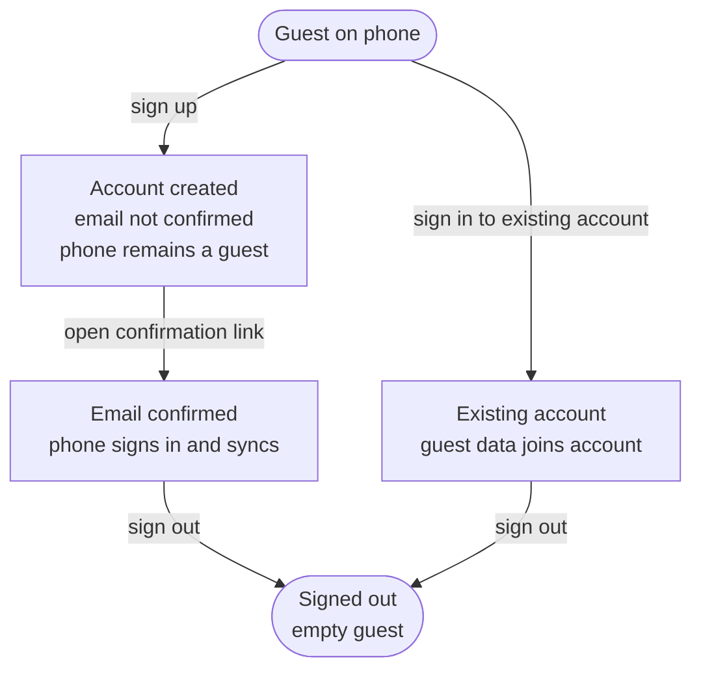
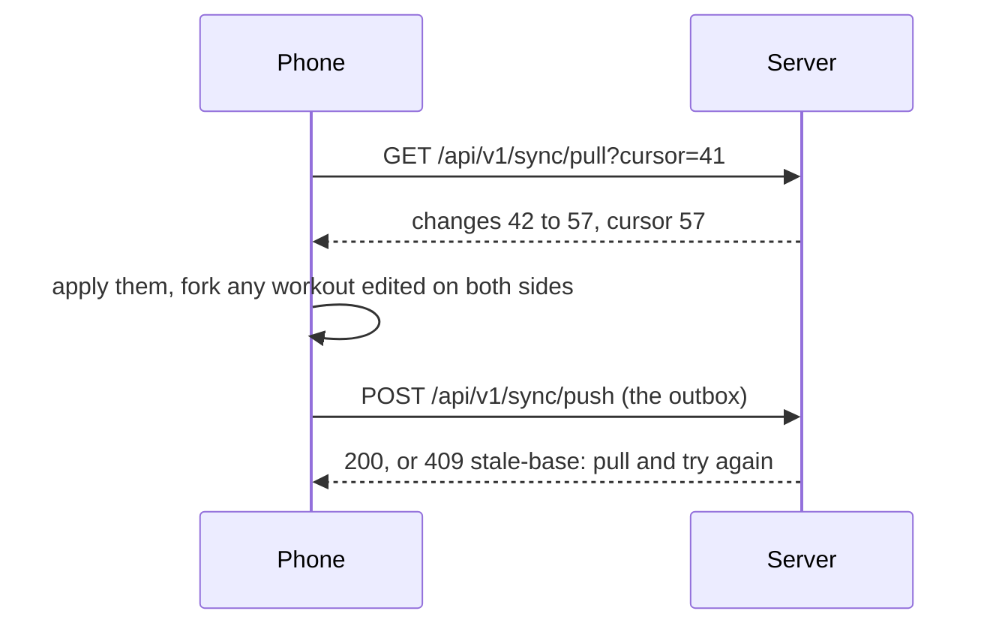

# Accounts

What a guest gets by signing up, and what the server and the phones do with an **account**. This is the spec for [#25](https://github.com/tkint/coach-poulpy/issues/25); the tickets built from it are its sub-issues. How a request is authenticated is in [The API](./the-api.md) and [ADR 0020](./adr/0020-every-credential-resolves-to-one-caller.md); the phone stays the source of truth ([ADR 0001](./adr/0001-local-first-phone-is-the-source-of-truth.md)).

## Signing up and signing in

- **Mobile sign-up uses email and password.** Sign in with Apple and Google are not implemented. Passwords are hashed with Argon2id.
- **The email is confirmed before any data leaves the phone.** Until the link is opened, the phone remains a guest and uploads nothing. Health-data consent is required at sign-up.
- **The confirmation link can open in the app or a browser.** The app keeps a random pending key and listens for the matching confirmation event. If the link opens in a browser, the event lets the waiting app sign in without repeatedly trying the password. It checks once on app open and after reconnecting too. The pending key identifies only that sign-up attempt; it does not reveal whether an address has an account.
- **A confirmed phone signs in with the password it kept temporarily.** It stores access and refresh tokens in the platform's secure store, then begins sync. The confirmation sheet waits until a guided session or Live recording ends before appearing ([#319](https://github.com/tkint/coach-poulpy/issues/319)).
- **Forgotten password**: the person requests a reset link by email and chooses a new password. The server revokes every device's sign-in.
- **Sign-in never reveals whether an email has an account**: an unknown address and a wrong password receive the same refusal. A pending registration can resend its link or restart with another address; the old address remains unconfirmed, no data leaves the phone, and the response never reveals whether that address was already registered. Expired or used confirmation links have a separate recovery screen.
- **Mail goes out over SMTP** to the provider configured on the server.

### Mobile sign-up and email confirmation

The app creates the pending account and keeps the password and a random pending key in its secure store. The email link can be opened on the phone or another device. The browser confirms the email but does not create a browser session; the waiting phone signs itself in when it hears the matching event.

```mermaid
sequenceDiagram
    autonumber
    actor Person
    participant App as Mobile app
    participant API as Account API
    participant DB as Postgres
    participant Mail as SMTP provider
    participant Browser as Browser / email link

    Person->>App: Submit email, password and health-data consent
    App->>App: Generate pending key; keep pending credentials securely
    App->>API: POST /api/v1/accounts (pendingKey)
    API->>DB: Create unconfirmed account and confirmation watch
    API->>Mail: Send /confirm-email#token link
    API-->>App: 202 Accepted (same for existing addresses)
    App->>API: POST /api/v1/accounts/confirmation-status
    API-->>App: confirmed = false
    App->>API: GET /api/v1/accounts/confirmation-events (Pending-Key header)
    Person->>Browser: Open confirmation email link
    Browser->>API: POST /api/v1/accounts/confirm (token)
    API->>DB: Consume one-time token; mark email confirmed
    API-->>Browser: 204 No Content
    API-->>App: confirmed event on matching SSE stream
    App->>API: POST /api/v1/accounts/confirmation-status (after event / reconnect)
    API-->>App: confirmed = true
    App->>API: POST /oauth/token (password grant)
    API->>DB: Verify confirmed account and password
    API-->>App: Access + refresh tokens
    App->>App: Store tokens in Keychain / Android Keystore
    App->>API: GET /api/v1/sync/pull, then POST /api/v1/sync/push
    API-->>App: Account data and accepted guest data
```

If the link opens inside the app, the app calls the same confirmation endpoint directly and then signs in. The pending key is a confirmation-watch capability, not an access token. If the address is already confirmed, the API still answers sign-up with 202 but sends no new confirmation email.

### Mobile sign-in and token refresh

```mermaid
sequenceDiagram
    autonumber
    actor Person
    participant App as Mobile app
    participant API as OAuth / account API
    participant DB as Postgres

    Person->>App: Enter email and password
    App->>API: POST /oauth/token (grant_type=password, device_name)
    API->>DB: Verify password and confirmed email
    alt Credentials valid and email confirmed
        API-->>App: 200 access token (15 min) + refresh token
        App->>App: Store tokens in Keychain / Android Keystore
        opt Phone contains guest data
            App->>API: GET /sync/pull
            API-->>App: Account changes
            App->>API: POST /sync/push (local outbox)
            API-->>App: 200; guest data joins account
        end
        opt Access token expires soon or request gets 401
            App->>API: POST /oauth/token (grant_type=refresh_token)
            API->>DB: Consume current refresh token
            API-->>App: New access + refresh token pair
            App->>App: Replace stored token pair
        end
    else Wrong password, unknown account or unconfirmed email
        API-->>App: 400 invalid_grant (same refusal)
    else Five failed attempts in 15 minutes
        API-->>App: 429 with Retry-After
    end
```

Each refresh token works once. A refused or reused refresh token signs the phone out; the app becomes a guest but keeps its local data.

### Password reset (mobile request, browser or app link)

```mermaid
sequenceDiagram
    autonumber
    actor Person
    participant App as Mobile app
    participant API as Account API
    participant DB as Postgres
    participant Mail as SMTP provider
    participant Link as Browser or app link handler

    Person->>App: Request password reset for email
    App->>API: POST /api/v1/password-resets
    API->>DB: Find confirmed account; enforce 3 links/hour
    API->>Mail: Send /reset-password#token (only if eligible)
    API-->>App: 202 Accepted for every address
    Person->>Link: Open reset link and enter new password
    Link->>API: POST /api/v1/password-resets/confirm (token, password)
    API->>DB: Consume one-hour token; update password; revoke all device tokens
    API-->>Link: 204 No Content
    Note over App,API: All existing sessions are revoked; each client signs out when refresh is refused
```

The browser reset page and the mobile app use the same one-time token endpoint. A reset token expires after one hour; successful reset revokes every device and invalidates the account's other reset links. The API always answers 202 to the request, including unknown addresses, and sends at most three links per account per hour.

## The phone and the account



- **The first upload keeps every id** ([ADR 0005](./adr/0005-ids-are-uuidv7-made-on-the-device.md)).
- **Signing in on a phone that has guest data merges it** into the account. Ids never collide and sync keeps both edits ([ADR 0006](./adr/0006-sync-keeps-both-edits.md)), so nothing is lost or overwritten.
- **Signing out clears the phone once everything is uploaded.** If some changes can't be uploaded (no connection), the phone says so and lets the person wait or sign out anyway. The phone then starts again as an empty guest, so the next person on a shared phone sees nothing.

## Sync

Phones sync through the account with two calls, push and pull ([ADR 0006](./adr/0006-sync-keeps-both-edits.md), [ADR 0025](./adr/0025-the-phone-forks-a-conflicting-workout-and-the-server-counts-changes.md)). Both need the `sync` scope, so only the apps can call them.



### When it runs

Only once the email is confirmed, and only while the app is open: when it opens, five seconds after a change, and on pull to refresh. Each run pulls first, then pushes. There is no background sync yet; it would need testing on real phones.

### Pull

`GET /api/v1/sync/pull?cursor=<cursor>&limit=500` answers `{"changes": [...], "cursor": "...", "more": true}`. The phone keeps calling with the new cursor while `more` is true. With no cursor it gets everything, as a phone signing in does.

The cursor is a counter on the account, not a time. Every row the server writes for the account, a deletion included, takes the next number, under a lock on the account row, so two pushes never interleave their numbers and a pull never skips one. The phones' clocks play no part.

A pull also returns the phone's own changes. Applying a change twice changes nothing, so the phone doesn't need to tell them apart. A plan, body measurement, setting or session header whose own change still waits in the outbox keeps the phone's value: the push that follows sends it, and the server keeps the later write.

### Push

`POST /api/v1/sync/push` sends `{"changes": [...]}`, at most 500 changes or 1 MB, oldest first. The phone keeps an outbox: each local write adds its change in the same transaction, and a push that is accepted removes what it carried. The profile, units and language live in the phone's small key-value store rather than its database, so their change is added just after the write instead. Nothing is added while the phone is a guest or its email is unconfirmed.

- **One push is one transaction**: all of it is stored, or none of it.
- **Every change is idempotent**, so a push whose answer was lost is simply sent again.
- **409 `stale-base`** names the workouts whose starting version is out of date. The phone pulls, forks them (below) and pushes again.
- **400 `invalid-change`** gives the index of a change that doesn't parse or breaks a rule. The server checks workout content with the shared Kotlin types ([ADR 0007](./adr/0007-postgres-columns-for-structure-jsonb-for-content.md)). The phone drops that change from its outbox, since it would be refused again and hold back the ones after it.

### How each kind of change merges

| Change | Carries | Merges |
| --- | --- | --- |
| `workout-version` | the `workout` as the shared Kotlin type (its id, `version`, name, format and parts), `baseVersion`, created at | Versions never change once made. The server takes version n + 1 only when its latest is n; the same version again with the same content changes nothing. Anything else is `stale-base`. |
| `workout-deleted` | workout id, the version deleted, when | **The edit wins.** If another phone already pushed a newer version, the delete is ignored and the workout comes back on the phone that deleted it. |
| `session` | the session's header: id, source, workout id and version, start, end, name, format, totals | Only the phone that recorded a session writes it, so the latest push of its header wins. |
| `session-events` | session id, and events with their `seq`, time and payload | A union: an event already stored by `(session id, seq)` is skipped ([ADR 0003](./adr/0003-sessions-are-append-only-event-logs.md)). |
| `session-deleted` | session id, when | Deletes the session and its events on every phone; it can't come back, since nobody else edits it. |
| `planned-workout` | id, workout id, day, created at, when the day was last set | The latest day wins. |
| `planned-workout-deleted` | id, when | The latest write wins, a move or the delete. |
| `body-measurement` | metric, day, value (or none, to delete), when | One per metric and day: the latest write wins, so two phones logging a weight the same day keep the later one. |
| `setting` | key, value (or none), when | The latest write wins per key. The keys are the profile's fields, units and language. Theme, app icon and paired devices aren't synced. |

The latest write is judged by the time the phone gives with the change. A phone with a wrong clock can lose a race on a small field, never a workout or a session.

### A workout edited on two phones

Both phones made version 3 from version 2. The first push wins. The second phone gets `stale-base`, pulls the other version 3, and keeps its own edit as a copy:

1. Its unsent versions of that workout become a new workout, with a new id, at version 1 with the latest of those edits, named after the phone: "Leg day (Ana's iPhone)".
2. Its sessions and planned workouts that pointed at those unsent versions now point at the copy.
3. The outbox is rewritten to push the copy, and the push is sent again.

Both phones then show both workouts, and nothing on the server is rewritten.

### Signing up, signing in and out

- **The first upload** is the whole local database put in the outbox once the email is confirmed, with every id kept.
- **Signing in on a phone with guest data** pulls everything, then pushes the whole local database the same way. Ids never collide, so this is a union. Same-day body measurements and profile fields keep the latest write.
- **Signing out** with an empty outbox revokes the sign-in, then clears the workouts, sessions, planned workouts, body log, profile, units, language, the outbox and the cursor. With changes still in the outbox, the phone offers to wait or sign out anyway.
- **When the server refuses the refresh token**, the phone becomes a guest again and keeps its data, which happens after a password reset, the account's deletion or a revoked sign-in. Its outbox and cursor are cleared. Signing in again pushes everything once more, and nothing is duplicated.

## What follows the account

| Follows the account | Stays on each phone |
| --- | --- |
| Workouts, plans, enrollments, sessions | Theme |
| Profile and body log | App icon |
| Units and language | Paired treadmills and other devices |

## Leaving

- **Deleting the account happens at once**, after the password: every row is deleted, every phone is signed out and goes back to a guest with its own copy, and the nightly dumps age out within 30 days. A wrong password leaves the account untouched.
- **Export** gives all the account's data as JSON, and sessions as FIT files.

## Screens

The agreed account screens and their states are in the [Mockups gallery](https://tkint.github.io/coach-poulpy/mockups/) under Mobile → Agreed → Accounts. The mockups own layout, copy and visual states; the behavior and security rules are defined above.

## Not yet

Apple and Google sign-in, the website's sign-in, sharing and coaching, and personal access tokens ([#228](https://github.com/tkint/coach-poulpy/issues/228)).
