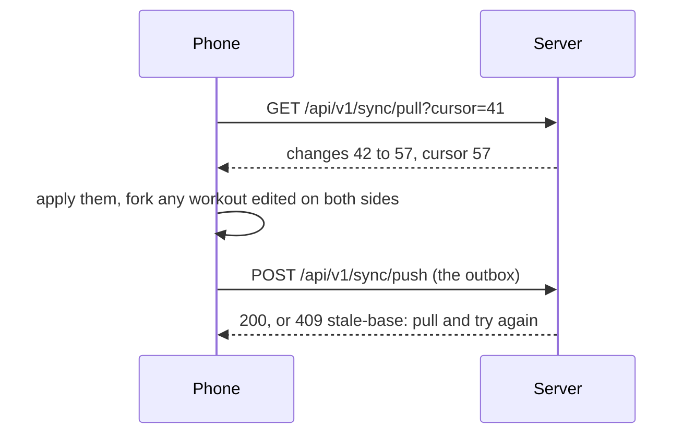

# Accounts

What a guest gets by signing up, and what the server and the phones do with an **account**. This is the spec for [#25](https://github.com/tkint/coach-poulpy/issues/25); the tickets built from it are its sub-issues. How a request is authenticated is in [The API](./the-api.md) and [ADR 0020](./adr/0020-every-credential-resolves-to-one-caller.md); the phone stays the source of truth ([ADR 0001](./adr/0001-local-first-phone-is-the-source-of-truth.md)).

## Signing up and signing in

- **Email and password only, for now.** Sign in with Apple and Google come later, each as one new authenticator; no route changes. Passwords are hashed with Argon2id.
- **The email is confirmed before any data leaves the phone.** Signing up sends a link; until it is tapped, the phone keeps working as a guest and uploads nothing. A typo in the address can never tie health data to someone else's mailbox.
- **The link can be opened anywhere**, on the phone or on a computer. While the app is in front and the email waits, the phone listens on a server-sent event stream, and the server tells it the moment the link is opened; the phone then signs in with the password it kept and shows Email confirmed in a sheet, over whichever tab is open. While a guided session plays or Live records, Email confirmed waits until it ends, so nothing covers the workout ([#319](https://github.com/tkint/coach-poulpy/issues/319)). A dropped stream is opened again 3 seconds later, after a check for what it missed, and the app checks once on each open too. The phone proves it is the one that signed up with a random key sent at sign-up, rather than by trying the password, which would count towards the 5 refused sign-ins that lock an address. The key follows only the link mailed with it, so it never tells who owns an address.
- **Health data consent is asked at sign-up**, with a link to what is stored and why.
- **Forgotten password**: the person asks for a reset link by email and chooses a new password; every phone is signed out.
- **Sign-in never reveals whether an email has an account**: an unknown address and a wrong password receive the same refusal. A pending registration can resend its link or restart with another address; the old address remains unconfirmed, no data leaves the phone, and the response never reveals whether that address was already registered. Expired or used confirmation links have a separate recovery screen.
- **Mail goes out over plain SMTP** to an EU provider set in the server's settings, so the provider can change without a code change.

## The phone and the account

- **The first upload keeps every id** ([ADR 0005](./adr/0005-ids-are-uuidv7-made-on-the-device.md)).
- **Signing in on a phone that has guest data merges it** into the account. Ids never collide and sync keeps both edits ([ADR 0006](./adr/0006-sync-keeps-both-edits.md)), so nothing is lost or overwritten.
- **Signing out clears the phone once everything is uploaded.** If some changes can't be uploaded (no connection), the phone says so and lets the person wait or sign out anyway. The phone then starts again as an empty guest, so the next person on a shared phone sees nothing.

## Sync

Phones sync through the account with two calls, push and pull ([ADR 0006](./adr/0006-sync-keeps-both-edits.md), [ADR 0025](./adr/0025-the-phone-forks-a-conflicting-workout-and-the-server-counts-changes.md)). Both need the `sync` scope, so only the apps can call them.

### When it runs

Only once the email is confirmed, and only while the app is open: when it opens, five seconds after a change, and on pull to refresh. Each run pulls first, then pushes. There is no background sync yet; it would need testing on real phones.

### Pull

`GET /api/v1/sync/pull?cursor=<cursor>&limit=500` answers `{"changes": [...], "cursor": "...", "more": true}`. The phone keeps calling with the new cursor while `more` is true. With no cursor it gets everything, as a phone signing in does.

The cursor is a counter on the account, not a time. Every row the server writes for the account, a deletion included, takes the next number, under a lock on the account row, so two pushes never interleave their numbers and a pull never skips one. The phones' clocks play no part.

A pull also returns the phone's own changes. Applying a change twice changes nothing, so the phone doesn't need to tell them apart. A plan, body measurement, setting or session header whose own change still waits in the outbox keeps the phone's value: the push that follows sends it, and the server keeps the later write.

### Push

`POST /api/v1/sync/push` sends `{"changes": [...]}`, at most 500 changes or 1 MB, oldest first. The phone keeps an outbox: each local write adds its change in the same transaction, and a push that is accepted removes what it carried. The profile, units and language live in the phone's small key-value store rather than its database, so their change is added just after the write instead. Nothing is added while the phone is a guest or its email is unconfirmed.

- **One push is one transaction**: all of it is stored, or none of it.
- **Every change is idempotent**, so a push whose answer was lost is simply sent again.
- **409 `stale-base`** names the workouts whose starting version is out of date. The phone pulls, forks them (below) and pushes again.
- **400 `invalid-change`** gives the index of a change that doesn't parse or breaks a rule. The server checks workout content with the shared Kotlin types ([ADR 0007](./adr/0007-postgres-columns-for-structure-jsonb-for-content.md)). The phone drops that change from its outbox, since it would be refused again and hold back the ones after it.

### How each kind of change merges

| Change | Carries | Merges |
| --- | --- | --- |
| `workout-version` | the `workout` as the shared Kotlin type (its id, `version`, name, format and parts), `baseVersion`, created at | Versions never change once made. The server takes version n + 1 only when its latest is n; the same version again with the same content changes nothing. Anything else is `stale-base`. |
| `workout-deleted` | workout id, the version deleted, when | **The edit wins.** If another phone already pushed a newer version, the delete is ignored and the workout comes back on the phone that deleted it. |
| `session` | the session's header: id, source, workout id and version, start, end, name, format, totals | Only the phone that recorded a session writes it, so the latest push of its header wins. |
| `session-events` | session id, and events with their `seq`, time and payload | A union: an event already stored by `(session id, seq)` is skipped ([ADR 0003](./adr/0003-sessions-are-append-only-event-logs.md)). |
| `session-deleted` | session id, when | Deletes the session and its events on every phone; it can't come back, since nobody else edits it. |
| `planned-workout` | id, workout id, day, created at, when the day was last set | The latest day wins. |
| `planned-workout-deleted` | id, when | The latest write wins, a move or the delete. |
| `body-measurement` | metric, day, value (or none, to delete), when | One per metric and day: the latest write wins, so two phones logging a weight the same day keep the later one. |
| `setting` | key, value (or none), when | The latest write wins per key. The keys are the profile's fields, units and language. Theme, app icon and paired devices aren't synced. |

The latest write is judged by the time the phone gives with the change. A phone with a wrong clock can lose a race on a small field, never a workout or a session.

### A workout edited on two phones

Both phones made version 3 from version 2. The first push wins. The second phone gets `stale-base`, pulls the other version 3, and keeps its own edit as a copy:

1. Its unsent versions of that workout become a new workout, with a new id, at version 1 with the latest of those edits, named after the phone: "Leg day (Ana's iPhone)".
2. Its sessions and planned workouts that pointed at those unsent versions now point at the copy.
3. The outbox is rewritten to push the copy, and the push is sent again.

Both phones then show both workouts, and nothing on the server is rewritten.

### Signing up, signing in and out

- **The first upload** is the whole local database put in the outbox once the email is confirmed, with every id kept.
- **Signing in on a phone with guest data** pulls everything, then pushes the whole local database the same way. Ids never collide, so this is a union. Same-day body measurements and profile fields keep the latest write.
- **Signing out** with an empty outbox revokes the sign-in, then clears the workouts, sessions, planned workouts, body log, profile, units, language, the outbox and the cursor. With changes still in the outbox, the phone offers to wait or sign out anyway.
- **When the server refuses the refresh token**, the phone becomes a guest again and keeps its data, which happens after a password reset, the account's deletion or a revoked sign-in. Its outbox and cursor are cleared. Signing in again pushes everything once more, and nothing is duplicated.

## What follows the account

| Follows the account | Stays on each phone |
| --- | --- |
| Workouts, plans, enrollments, sessions | Theme |
| Profile and body log | App icon |
| Units and language | Paired treadmills and other devices |

## Leaving

- **Deleting the account happens at once**, after the password: every row is deleted, every phone is signed out and goes back to a guest with its own copy, and the nightly dumps age out within 30 days.
- **Export** gives all the account's data as JSON, and sessions as FIT files.

## Screens

The agreed account screens and their states are in the [Mockups gallery](https://tkint.github.io/coach-poulpy/mockups/) under Mobile → Agreed → Accounts. The mockups own layout, copy and visual states; the behavior and security rules are defined above.
## Not yet

Apple and Google sign-in, the website's sign-in, sharing and coaching, and personal access tokens ([#228](https://github.com/tkint/coach-poulpy/issues/228)).
