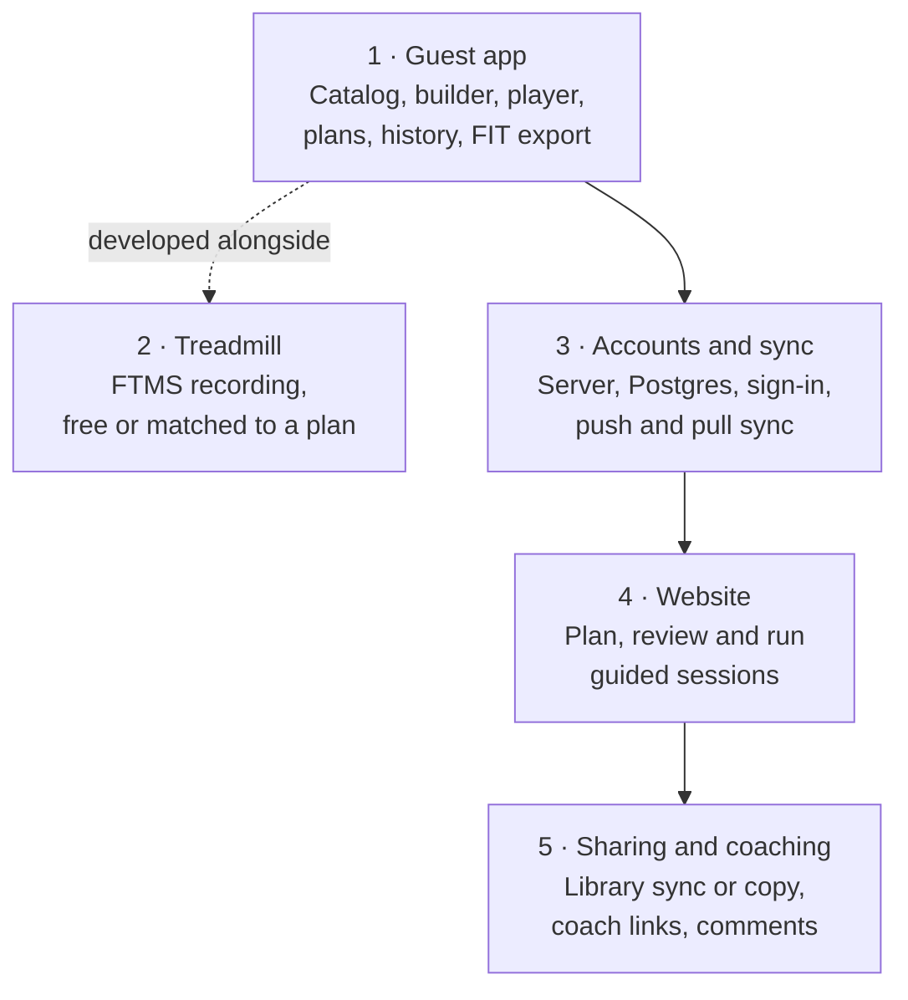
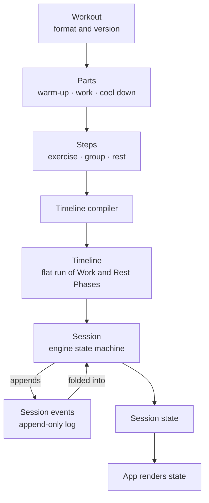
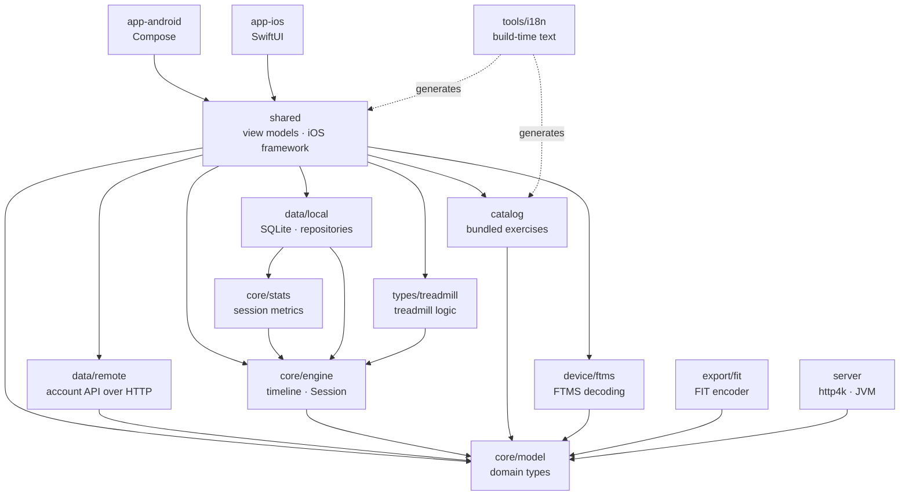
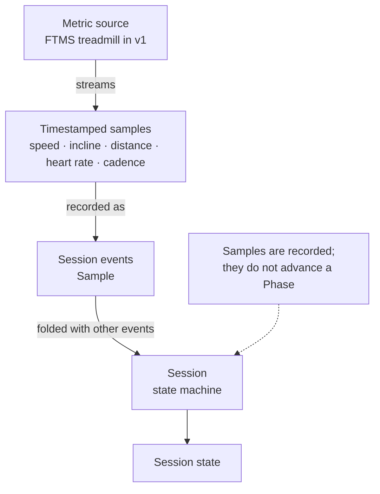

# Architecture

Coach Poulpy is **local-first**: the mobile app holds the whole domain model and runs alone as a guest on family phones, and the server and website join later as a sync and sharing layer over the same model. One Kotlin Multiplatform core owns the domain, the workout engine and the database on Android and iOS, so the two apps cannot drift apart. The decisions behind this are recorded as [ADRs](./adr/); the words are defined in the [glossary](../CONTEXT.md).

## Decisions for v1

| Topic | v1 | Later |
| --- | --- | --- |
| Audience | The family, as guests | A public app |
| Accounts | Guest mode, all data on the phone; email and password, Sign in with Apple and Google when the server arrives | Guest data moves into a new account on sign-up |
| Website | Needs an account; plans, manages, reviews and runs guided sessions without devices | |
| Catalog | Built-in and curated, with simple images; no user-created exercises | User-created exercises with duplicate detection |
| Workouts | Circuit or sets, in parts (warm-up, work, cool down); strength, cardio, rehab, stretching and treadmill walks and runs | Outdoor running, walking, swimming with GPS; workout tags |
| Treadmill | FTMS read and record, alone or checked against a planned workout | Speed and incline control per phase |
| Progression | Every week written out by hand | Rules from recognised protocols, driven by sessions and goals |
| Sharing | Save to library synced with the author or as a copy | |
| Coaching | Athlete invites a coach and can revoke; coach edits assigned plans and comments on sessions | |
| Export | .FIT file for Garmin Connect and Strava; optional Apple Health and Health Connect | Direct Garmin and Strava links |
| Language and units | French and English, metric and imperial: distances, speeds and weights follow the setting (weights are stored in kilograms and shown in pounds in imperial), except a distance picked in whole miles or kilometres, which keeps the unit it was picked in | |
| Hosting | The whole stack runs on the dev computer; the server deploys with Docker to one server ([ADR 0019](./adr/0019-the-server-runs-with-docker-compose-on-one-server.md)) | A bigger machine or a managed database when it runs short |

## Delivery phases

Each phase adds a layer without reworking the one below it, because the domain, engine and storage are already shared. Phase 2 runs alongside phase 1 because the treadmill link was the riskiest piece. GitHub milestones follow these phases.

## Domain model

Every workout shares the same concepts, whatever its format. Planned content is versioned and immutable per version, so a session always points at the exact version it followed, a synced library entry follows the latest version, and a copy forks from one.

| Concept | What it holds |
| --- | --- |
| Exercise | Stable slug, names in French and English, movement pattern, muscle groups, equipment needs (each a list of alternatives) and optional equipment, measurement (reps, time, distance, hold), per-side flag, images, instruction steps |
| Workout | Name, format (circuit or sets), parts (an optional warm-up, one or more work parts, an optional cool down) each holding a tree of steps, estimated duration, tags |
| Step | An exercise step (exercise, prescription, and a role: exercise or recover), a group (sequence, superset, circuit, interval set with rounds), or a rest |
| Prescription | Sets, and per set a target (reps, duration, distance, hold), an optional load, intensity (RPE, speed, incline, heart rate zone), tempo, and rest before the next set |
| Plan | Name, goal, weeks of days, each day holding zero or more workouts |
| Enrollment | A person following a plan version from a start date, with one calendar entry per scheduled workout (planned, done, skipped, moved) |
| Goal | A measurable target with an optional deadline, computed from sessions |
| Session | One workout actually done: start and end, source (guided, free, device only), optional link to the planned workout version and calendar entry, set results, samples, notes, effort and pain |

Statistics are derived, never typed in. `core/stats` computes metrics from sessions: personal records, weekly load and goal progress all come from the same computation, on the phone for guests and on the server for accounts.

Sharing and coaching add three small concepts: a library entry (synced or copy), a coach link (status, revocation date) and a comment attached to a session, a set result or a calendar entry.

## Formats, parts and the engine

A workout's format is chosen when it is created ([ADR 0013](./adr/0013-workouts-have-a-format-not-a-type.md)):

| Format | Built as | An exercise holds |
| --- | --- | --- |
| Circuit | Rounds through several exercises: a repeat around them | One set: reps, time or hold and a load; a walk or run has a duration and an intensity |
| Sets | One exercise at a time, all its sets, then the next; repeats for supersets | Its sets, each with a target and load, and the rest between sets |

How a step finishes comes from its target alone: a time or a hold runs a timer; reps, a distance (unless a treadmill reports it) or "until button press" wait for a tap.

The clock is injected, so tests never wait; each platform turns cues (3-2-1, switch sides, next exercise) into sound, vibration and text. A killed app resumes from the event log: Open restores a session paused at its last event (guided sessions in the player, Live recordings in Live); Discard deletes it. A session closed without finishing ends at its last event and keeps its totals.

The shared engine runs on each platform ([ADR 0002](./adr/0002-one-kotlin-multiplatform-core.md)); session state is folded from its append-only events ([ADR 0003](./adr/0003-sessions-are-append-only-event-logs.md)).

## Modules

Solid arrows are module dependencies in the current Gradle build; dashed arrows show build-time text generation.

Android and iOS both depend on `shared`; iOS consumes its `Shared` framework. The server is now a built JVM/http4k module, not a future component. The web workspace is separate from the Gradle graph: `web/app` is a Vue app built on `web/ui` (Vue and DaisyUI) and calls the server over HTTP. A shared Kotlin/JS engine and a separate sync module are not part of the current build.

## Text and translations

User-facing text lives in `i18n/messages/<locale>/<namespace>.json`; native string resources and catalog text are generated at build time. See the [translation files' README](../i18n/README.md) and [ADRs 0014](./adr/0014-text-lives-in-one-json-file-per-language-and-namespace.md) and [0015](./adr/0015-catalog-text-lives-in-translation-files.md).

## Storage and sync

The phone database is the source of truth; the server is its replica ([ADR 0001](./adr/0001-local-first-phone-is-the-source-of-truth.md)). The sync protocol and conflict handling are described in [Accounts](./accounts.md#sync) and [ADR 0006](./adr/0006-sync-keeps-both-edits.md).

- Device-generated ids are UUIDv7 ([ADR 0005](./adr/0005-ids-are-uuidv7-made-on-the-device.md)).
- The catalog is curated, separate from personal-data sync, and updated without an account ([ADR 0008](./adr/0008-curated-catalog-with-stable-slugs.md), [ADR 0026](./adr/0026-the-server-holds-the-catalog-as-a-draft-and-published-versions.md)).
- The server's Postgres schema uses SQLDelight migrations, applied on start ([ADR 0022](./adr/0022-the-servers-schema-is-sqldelight-migrations-on-postgres.md)).

## Devices

Treadmills are read-only metric sources in v1 ([ADR 0010](./adr/0010-treadmills-are-read-only-metric-sources.md)).

On Android a Live recording runs in a connected-device foreground service, from Start until it finishes or is discarded, with an ongoing notification that opens Live and has Pause or Resume and Finish buttons; on Android 14 and later it needs the Bluetooth permission, and without it a timer-only recording runs in the app alone. On iOS the Bluetooth background mode keeps recording on a locked phone, and Kable's central has a restore identifier so the system relaunches the app for the device's data after closing it. Guided sessions in the player have neither: they rely on the screen staying on, and on resuming from their events. A dropped link is retried for 60 seconds while the session keeps its timer, and the gap is marked in the samples rather than filled. Many treadmills send only some FTMS fields, so the decoder reads the feature flags first and the UI hides what a machine does not send.

## Accounts and security

Guests keep their data on the phone. After email confirmation, an account can sync that data between phones and use the website. The sign-in, sync and account lifecycle are specified in [Accounts](./accounts.md); request authentication and routes are in [The API](./the-api.md). Admin access has its own [security rules](./admin.md#who-can-open-it) ([ADR 0020](./adr/0020-every-credential-resolves-to-one-caller.md)).

## Deployment

The server is one JVM program in a Docker image, run with Docker Compose behind Caddy ([ADR 0019](./adr/0019-the-server-runs-with-docker-compose-on-one-server.md)). See [Releasing](./releasing.md) for app releases and [Deploying the server](./deploying-the-server.md) for hosting.
