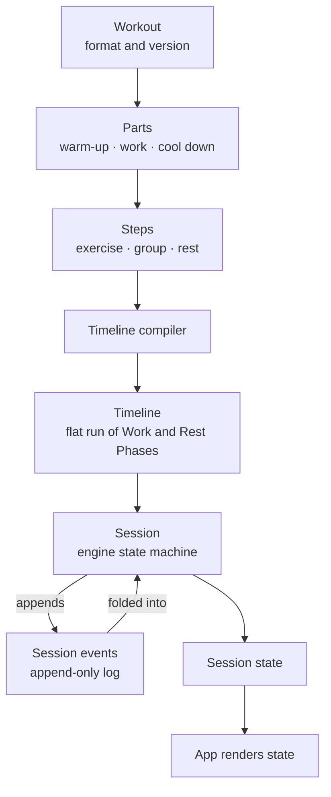
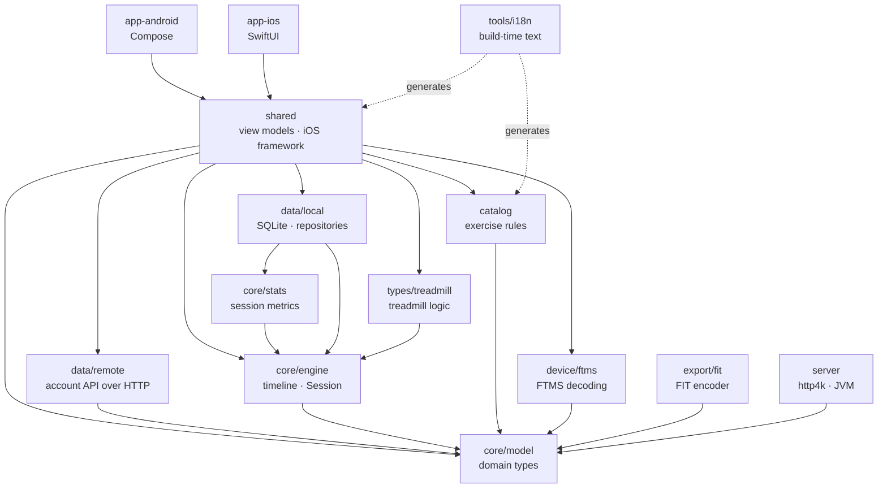
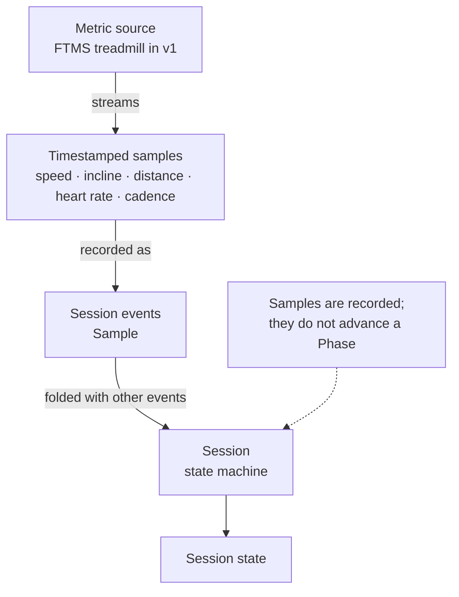

# Architecture

Coach Poulpy is **local-first**: the mobile app holds the whole domain model and runs alone as a guest on family phones, and the server adds accounts and sync between phones; the website reads the account's workouts, and sharing and coaching follow over the same model. One Kotlin Multiplatform core owns the domain, the workout engine and the database on Android and iOS, so the two apps cannot drift apart. The decisions behind this are recorded as [ADRs](./adr/), the words are defined in the [glossary](../CONTEXT.md), and what ships in which order, and what v1 includes, is in the [roadmap](./roadmap.md). Each layer is added without reworking the one below it, because the domain, engine and storage are shared.

## Domain model

Every workout shares the same concepts, whatever its format. Planned content is versioned and immutable per version, so a session always points at the exact version it followed, a synced library entry follows the latest version, and a copy forks from one.

What each concept holds (exercise, workout, step, prescription, plan, enrollment, goal, session, library entry, coach link) is defined in the [glossary](../CONTEXT.md).

Statistics are derived, never typed in. A session's totals (`core/stats`) are saved next to it when it ends, so the history opens without replaying its events; sessions that ended before that are summed once. `core/stats` computes metrics from sessions: personal records, weekly load and goal progress all come from the same computation, on the phone for guests and on the server for accounts.

## Formats, parts and the engine

A workout's format is chosen when it is created ([ADR 0013](./adr/0013-workouts-have-a-format-not-a-type.md)):

| Format | Built as | An exercise holds |
| --- | --- | --- |
| Circuit | Rounds through several exercises: a repeat around them | One set: reps, time or hold and a load; a walk or run has a duration and an intensity |
| Sets | One exercise at a time, all its sets, then the next; repeats for supersets | Its sets, each with a target and load, and the rest between sets |

How a step finishes comes from its target alone: a time or a hold runs a timer; reps, a distance (unless a treadmill reports it) or "until button press" wait for a tap.

The clock is injected, so tests never wait; each platform turns cues (3-2-1, switch sides, next exercise) into sound, vibration and text. A killed app resumes from the event log: Open restores a session paused at its last event (guided sessions in the player, Live recordings in Live); Discard deletes it. A session closed without finishing ends at its last event and keeps its totals.

The shared engine runs on each platform ([ADR 0002](./adr/0002-one-kotlin-multiplatform-core.md)); session state is folded from its append-only events ([ADR 0003](./adr/0003-sessions-are-append-only-event-logs.md)).

## Modules

Module graph

Solid arrows are module dependencies in the current Gradle build; dashed arrows show build-time text generation.

- Android and iOS both depend on `shared`; iOS consumes it as the `Shared` framework.
- The server is a JVM module on http4k that shares `core/model` with the apps.
- The web workspace sits outside Gradle: `web/app` is a Vue app on `web/ui` (Vue and DaisyUI) that calls the server over HTTP.

## Text and translations

User-facing text lives in `i18n/messages/<locale>/<namespace>.json`; native string resources and catalog text are generated at build time. See the [translation files' README](../i18n/README.md) and [ADRs 0014](./adr/0014-text-lives-in-one-json-file-per-language-and-namespace.md) and [0015](./adr/0015-catalog-text-lives-in-translation-files.md).

## Storage and sync

The phone database is the source of truth; the server is its replica ([ADR 0001](./adr/0001-local-first-phone-is-the-source-of-truth.md)). The sync protocol and conflict handling are described in [Sync](./sync.md) and [ADR 0006](./adr/0006-sync-keeps-both-edits.md).

- Device-generated ids are UUIDv7 ([ADR 0005](./adr/0005-ids-are-uuidv7-made-on-the-device.md)).
- The catalog is curated, separate from personal-data sync, and updated without an account ([ADR 0008](./adr/0008-curated-catalog-with-stable-slugs.md), [ADR 0026](./adr/0026-the-server-holds-the-catalog-as-a-draft-and-published-versions.md)).
- The website reads the account's workouts from the API and gets their wording on request with `include=text`; the shared Kotlin builds it, so the website keeps no copy ([ADR 0027](./adr/0027-the-api-says-the-words-on-request.md)).
- The server's Postgres schema uses SQLDelight migrations, applied on start ([ADR 0022](./adr/0022-the-servers-schema-is-sqldelight-migrations-on-postgres.md)). The tables and how they relate are in [The server's database](./database.md).

## Devices

Treadmills are read-only metric sources in v1 ([ADR 0010](./adr/0010-treadmills-are-read-only-metric-sources.md)).

- **Android** runs a Live recording in a connected-device foreground service, with a notification to pause, resume or finish. On Android 14 and later it needs the Bluetooth permission; without it the recording is timer-only.
- **iOS** keeps recording on a locked phone with the Bluetooth background mode, and the system can relaunch the app for the device's data.
- **Guided sessions** in the player have neither. They keep the screen on and resume from their events.
- **A dropped link** is retried for 60 seconds while the timer keeps going, and the gap is marked in the samples, never filled.
- **Many treadmills send only some FTMS fields**, so the decoder reads the feature flags first and the screen hides what a machine doesn't send.

## Accounts and security

Guests keep their data on the phone. After email confirmation, an account can sync that data between phones and use the website. The sign-in, sync and account lifecycle are specified in [Accounts](./accounts.md); request authentication and routes are in [The API](./the-api.md). Admin access has its own [security rules](./admin.md#who-can-open-it) ([ADR 0020](./adr/0020-every-credential-resolves-to-one-caller.md)).

## Deployment

The server is one JVM program in a Docker image, run with Docker Compose behind Caddy ([ADR 0019](./adr/0019-the-server-runs-with-docker-compose-on-one-server.md)). See [Releasing](./releasing.md) for app releases and [Deploying the server](./deploying-the-server.md) for hosting.
