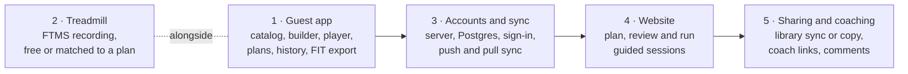
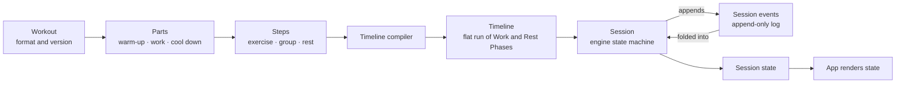
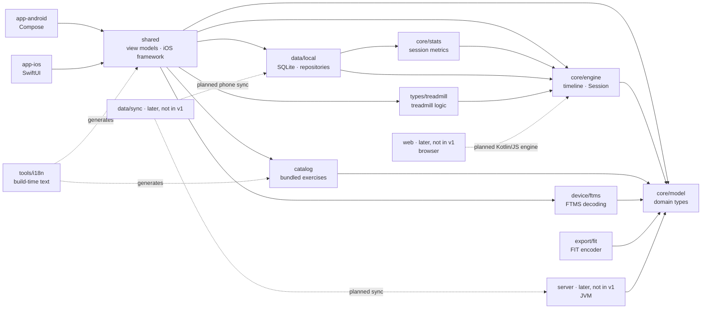
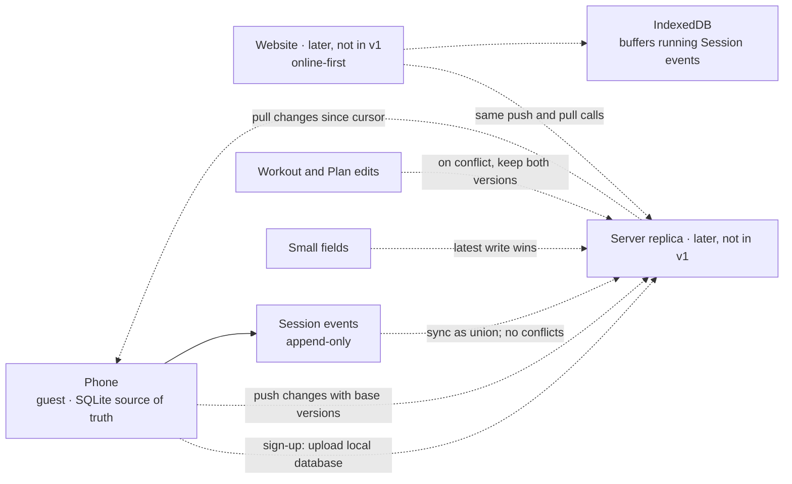
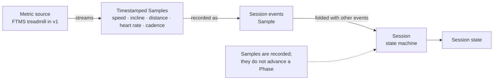

# Architecture

Coach Poulpy is **local-first**: the mobile app holds the whole domain model and runs alone as a guest on family phones, and the server and website join later as a sync and sharing layer over the same model. One Kotlin Multiplatform core owns the domain, the workout engine and the database on Android and iOS, so the two apps cannot drift apart. The decisions behind this are recorded as [ADRs](./adr/); the words are defined in the [glossary](../CONTEXT.md).

## Decisions for v1

| Topic | v1 | Later |
| --- | --- | --- |
| Audience | The family, as guests | A public app |
| Accounts | Guest mode, all data on the phone; email and password, Sign in with Apple and Google when the server arrives | Guest data moves into a new account on sign-up |
| Website | Needs an account; plans, manages, reviews and runs guided sessions without devices | |
| Catalog | Built-in and curated, with simple images; no user-created exercises | User-created exercises with duplicate detection |
| Workouts | Circuit or sets, in parts (warm-up, work, cool down); strength, cardio, rehab, stretching and treadmill walks and runs | Outdoor running, walking, swimming with GPS; workout tags |
| Treadmill | FTMS read and record, alone or checked against a planned workout | Speed and incline control per phase |
| Progression | Every week written out by hand | Rules from recognised protocols, driven by sessions and goals |
| Sharing | Save to library synced with the author or as a copy | |
| Coaching | Athlete invites a coach and can revoke; coach edits assigned plans and comments on sessions | |
| Export | .FIT file for Garmin Connect and Strava; optional Apple Health and Health Connect | Direct Garmin and Strava links |
| Language and units | French and English, metric and imperial: distances, speeds and weights follow the setting (weights are stored in kilograms and shown in pounds in imperial), except a distance picked in whole miles or kilometres, which keeps the unit it was picked in | |
| Hosting | The whole stack runs on the dev computer; the server deploys with Docker to one server ([ADR 0019](./adr/0019-the-server-runs-with-docker-compose-on-one-server.md)) | A bigger machine or a managed database when it runs short |

## Delivery phases

Each phase adds a layer without reworking the one below it, because the domain, engine and storage are already shared. Phase 2 runs alongside phase 1 because the treadmill link was the riskiest piece. GitHub milestones follow these phases.

## Domain model

Every workout shares the same concepts, whatever its format. Planned content is versioned and immutable per version, so a session always points at the exact version it followed, a synced library entry follows the latest version, and a copy forks from one.

| Concept | What it holds |
| --- | --- |
| Exercise | Stable slug, names in French and English, movement pattern, muscle groups, equipment needs (each a list of alternatives) and optional equipment, measurement (reps, time, distance, hold), per-side flag, images, instruction steps |
| Workout | Name, format (circuit or sets), parts (an optional warm-up, one or more work parts, an optional cool down) each holding a tree of steps, estimated duration, tags |
| Step | An exercise step (exercise, prescription, and a role: exercise or recover), a group (sequence, superset, circuit, interval set with rounds), or a rest |
| Prescription | Sets, and per set a target (reps, duration, distance, hold), an optional load, intensity (RPE, speed, incline, heart rate zone), tempo, and rest before the next set |
| Plan | Name, goal, weeks of days, each day holding zero or more workouts |
| Enrollment | A person following a plan version from a start date, with one calendar entry per scheduled workout (planned, done, skipped, moved) |
| Goal | A measurable target with an optional deadline, computed from sessions |
| Session | One workout actually done: start and end, source (guided, free, device only), optional link to the planned workout version and calendar entry, set results, samples, notes, effort and pain |

Statistics are derived, never typed in. `core/stats` computes metrics from sessions: personal records, weekly load and goal progress all come from the same computation, on the phone for guests and on the server for accounts.

Sharing and coaching add three small concepts: a library entry (synced or copy), a coach link (status, revocation date) and a comment attached to a session, a set result or a calendar entry.

## Formats, parts and the engine

A workout's format is chosen when it is created ([ADR 0013](./adr/0013-workouts-have-a-format-not-a-type.md)):

| Format | Built as | An exercise holds |
| --- | --- | --- |
| Circuit | Rounds through several exercises: a repeat around them | One set: reps, time or hold and a load; a walk or run has a duration and an intensity |
| Sets | One exercise at a time, all its sets, then the next; repeats for supersets | Its sets, each with a target and load, and the rest between sets |

How a step finishes comes from its target alone: a time or a hold runs a timer; reps, a distance (unless a treadmill reports it) or "until button press" wait for a tap.

The clock is injected, so tests never wait; each platform turns cues (3-2-1, switch sides, next exercise) into sound, vibration and text. A killed app resumes from the event log: Open restores a session paused at its last event (guided sessions in the player, Live recordings in Live); Discard deletes it. A session closed without finishing ends at its last event and keeps its totals.

The shared engine runs on each platform ([ADR 0002](./adr/0002-one-kotlin-multiplatform-core.md)); session state is folded from its append-only events ([ADR 0003](./adr/0003-sessions-are-append-only-event-logs.md)).

## Modules

Solid arrows are module dependencies in the current Gradle build; arrows labelled "planned" are not built in v1.

Android and iOS both depend on `shared`; iOS consumes its `Shared` framework.

## Text and translations

Every word a person reads is in `i18n/messages/<locale>/<namespace>.json` ([ADR 0014](./adr/0014-text-lives-in-one-json-file-per-language-and-namespace.md)). At build time `tools/i18n`, run by the `coachpoulpy.i18n` Gradle plugin, writes the Android `strings.xml`, the iOS `.strings` and `.stringsdict`, the shared `DomainText` object (one typed function per `domain` message, so a wrong id or argument fails the build) and the catalog with its text merged back in ([ADR 0015](./adr/0015-catalog-text-lives-in-translation-files.md)). None of it is committed, and the build fails when a shipped language lacks a message. How to add a string is in [the translation files' README](../i18n/README.md).

## Storage and sync

The phone database is the source of truth and the server is a replica ([ADR 0001](./adr/0001-local-first-phone-is-the-source-of-truth.md)); sync and the website are later work.

Sync follows [ADR 0006](./adr/0006-sync-keeps-both-edits.md).

- Ids are UUIDv7 made on the device ([ADR 0005](./adr/0005-ids-are-uuidv7-made-on-the-device.md)).
- Workouts and Plans keep both edits; small fields take the latest write ([ADR 0006](./adr/0006-sync-keeps-both-edits.md)).
- The catalog ships with the app and updates without an account ([ADR 0008](./adr/0008-curated-catalog-with-stable-slugs.md)).

## Devices

Treadmills are read-only metric sources in v1 ([ADR 0010](./adr/0010-treadmills-are-read-only-metric-sources.md)).

On Android a Live recording runs in a connected-device foreground service, from Start until it finishes or is discarded, with an ongoing notification that opens Live and has Pause or Resume and Finish buttons; on Android 14 and later it needs the Bluetooth permission, and without it a timer-only recording runs in the app alone. On iOS the Bluetooth background mode keeps recording on a locked phone, and Kable's central has a restore identifier so the system relaunches the app for the device's data after closing it. Guided sessions in the player have neither: they rely on the screen staying on, and on resuming from their events. A dropped link is retried for 60 seconds while the session keeps its timer, and the gap is marked in the samples rather than filled. Many treadmills send only some FTMS fields, so the decoder reads the feature flags first and the UI hides what a machine does not send.

## Accounts and security

- A guest's data never leaves the phone; the operating system's file encryption protects it.
- Sign-up pushes the whole local database as a first sync, keeping ids.
- Email and password hashed with Argon2id, plus Sign in with Apple and Google, whose ID tokens the server verifies.
- Every credential resolves to one caller (account, client, scopes) through one http4k filter ([the API](./the-api.md)); routes check scopes, every query is scoped by owner, and coach access is checked against an active coach link on each request ([ADR 0020](./adr/0020-every-credential-resolves-to-one-caller.md)).
- Tokens are opaque and stored hashed: 15-minute access tokens and rotating refresh tokens, in Keychain or Android Keystore on phones and an HttpOnly, SameSite cookie on the website. `GET /api/v1/me` tells a client who it is. Personal access tokens, then OAuth 2.1 for third-party apps and the MCP server, come with [#228](https://github.com/tkint/coach-poulpy/issues/228).
- The landing site, the web app and the API each have their own hostname and container: `coach-poulpy.com`, `app.coach-poulpy.com`, `api.coach-poulpy.com` ([ADR 0021](./adr/0021-the-landing-site-the-app-and-the-api-have-their-own-hostname.md)).
- Health data is sensitive under the GDPR: consent at sign-up, export as JSON and FIT, full deletion, hosting in the EU; token reads of health data are logged.

## Deployment

The first release needs no server. Android phones install the signed APK from CI; iPhones need Xcode (7-day installs with a free account) or TestFlight with a paid Apple Developer membership. The server builds into one JVM program in a Docker image, published with each release and run on one server with Docker ([ADR 0019](./adr/0019-the-server-runs-with-docker-compose-on-one-server.md)). [Deploying the server](./deploying-the-server.md) runs it there behind a Caddy that other apps can share.
