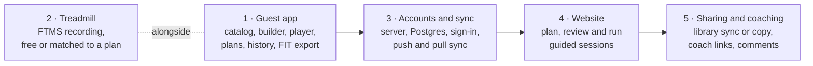

# Architecture

Coach Poulpy is **local-first**: the mobile app holds the whole domain model and runs alone as a guest on family phones, and the server and website join later as a sync and sharing layer over the same model. One Kotlin Multiplatform core owns the domain, the workout engine and the database on Android and iOS, so the two apps cannot drift apart. The decisions behind this are recorded as [ADRs](./adr/); the words are defined in the [glossary](../CONTEXT.md).

## Decisions for v1

| Topic | v1 | Later |
| --- | --- | --- |
| Audience | The family, as guests | A public app |
| Accounts | Guest mode, all data on the phone; email and password, Sign in with Apple and Google when the server arrives | Guest data moves into a new account on sign-up |
| Website | Needs an account; plans, manages, reviews and runs guided sessions without devices | |
| Catalog | Built-in and curated, with simple images; no user-created exercises | User-created exercises with duplicate detection |
| Workout types | Strength, conditioning, rehab, stretching and mobility, treadmill | Outdoor running, walking, swimming with GPS |
| Treadmill | FTMS read and record, alone or checked against a planned workout | Speed and incline control per phase |
| Progression | Every week written out by hand | Rules from recognised protocols, driven by sessions and goals |
| Sharing | Save to library synced with the author or as a copy | |
| Coaching | Athlete invites a coach and can revoke; coach edits assigned plans and comments on sessions | |
| Export | .FIT file for Garmin Connect and Strava; optional Apple Health and Health Connect | Direct Garmin and Strava links |
| Language and units | French and English, metric and imperial | |
| Hosting | The whole stack runs on the dev computer; Docker optional | A provider when accounts go live |

## Delivery phases

Each phase adds a layer without reworking the one below it, because the domain, engine and storage are already shared. Phase 2 runs alongside phase 1 because the treadmill link was the riskiest piece. GitHub milestones follow these phases.

## Domain model

Every workout type shares the same concepts; a type only adds its own step kinds, targets and rules. Planned content is versioned and immutable per version, so a session always points at the exact version it followed, a synced library entry follows the latest version, and a copy forks from one.

| Concept | What it holds |
| --- | --- |
| Exercise | Stable slug, names in French and English, movement pattern, muscle groups, equipment, measurement (reps, time, distance, hold), per-side flag, images, instruction steps |
| Workout | Name, workout type, a tree of steps, estimated duration, tags |
| Step | An exercise step (exercise and prescription), a group (sequence, superset, circuit, interval set with rounds), or a rest |
| Prescription | Sets, and per set a target (reps, duration, distance, hold), an optional load, intensity (RPE, speed, incline, heart rate zone), tempo, and rest after the set |
| Plan | Name, goal, weeks of days, each day holding zero or more workouts |
| Enrollment | A person following a plan version from a start date, with one calendar entry per scheduled workout (planned, done, skipped, moved) |
| Goal | A measurable target with an optional deadline, computed from sessions |
| Session | One workout actually done: start and end, source (guided, free, device only), optional link to the planned workout version and calendar entry, set results, samples, notes, effort and pain |

Statistics are derived, never typed in. Each workout type declares the metrics it produces, and `core/stats` computes them from sessions: personal records, weekly load per type and goal progress all come from the same computation, on the phone for guests and on the server for accounts.

Sharing and coaching add three small concepts: a library entry (synced or copy), a coach link (status, revocation date) and a comment attached to a session, a set result or a calendar entry.

## Workout types and the engine

Each workout type is a module behind `WorkoutTypeModule`: the targets it accepts, how its steps finish, what it records per set, and the metrics and FIT sport it maps to.

| Type | Targets | A step finishes | Recorded per set | Metrics |
| --- | --- | --- | --- | --- |
| Strength | Reps, load (kg, % 1RM, bodyweight, band), RPE, tempo | When the person taps done; rest starts by itself | Reps, load, RPE, failed or partial | Volume, estimated 1RM, records |
| Conditioning | Duration, reps, rounds; AMRAP, EMOM, Tabata, circuit | On a timer, with automatic transitions | Rounds and reps, time per round | Work time, density, rounds |
| Rehab | Reps, hold, light load, side, tempo | Manually or on a hold timer, per side | Reps or hold, pain 0 to 10, side | Pain trend, adherence |
| Mobility | Hold, breaths, side | Hold timer with automatic side switch | Hold done | Time in hold, sessions per region |
| Treadmill | Duration, distance, speed, incline, pace | Timer or distance from the device | Samples | Distance, pace, elevation, plan compliance |

The engine compiles a workout into a flat **timeline** of work, rest and transition phases, then runs it as a state machine that the UI only observes. The clock is injected, so the engine is testable without waiting. It emits **cues** (3-2-1, switch sides, next exercise) that each platform turns into sound, vibration and text. Every action is a **session event** written at once, so a killed app resumes at the same second.

## Modules

| Module | Runs on | Responsibility |
| --- | --- | --- |
| `core/model` | Android, iOS, JVM, JS | Domain types, serializable, no dependencies |
| `core/engine` | Android, iOS, JVM, JS | Timeline compiler, session state machine, event fold, `WorkoutTypeModule` |
| `types/*` | Android, iOS, JVM, JS | One module per workout type |
| `core/stats` | Android, iOS, JVM | Metrics, records, goal progress, weekly summaries |
| `catalog` | Android, iOS, JVM | The bundled, versioned exercise catalog |
| `data/local` | Android, iOS | SQLDelight schema, repositories, event storage, migrations |
| `data/sync` (later) | Android, iOS | Ktor client and the sync protocol; off for guests |
| `device/ftms` | Android, iOS | FTMS decoding in common code; Bluetooth through Kable |
| `export/fit` | Android, iOS, JVM | A small .FIT encoder |
| `shared` | Android, iOS | App view models; exported to iOS as the `Shared` framework |
| `app-android` | Android | Compose UI, a foreground service for sessions and Bluetooth, Health Connect |
| `app-ios` | iOS | SwiftUI UI, Bluetooth and audio background modes, HealthKit |
| `web` | Browser | Vue 3, TypeScript, Vite, Pinia; the engine through Kotlin/JS |
| `server` | JVM | http4k routes, Flyway, jOOQ, reusing model, types and stats for validation |

## Storage and sync

- The phone database is the source of truth; the server is a replica ([ADR 0001](./adr/0001-local-first-phone-is-the-source-of-truth.md)).
- Ids are UUIDv7 made on the device ([ADR 0005](./adr/0005-ids-are-uuidv7-made-on-the-device.md)).
- Sessions never conflict; workouts and plans keep both edits; small fields take the latest write ([ADR 0006](./adr/0006-sync-keeps-both-edits.md)).
- The website is online-first, using the same push and pull calls, and buffers a running session's events in IndexedDB.
- The catalog ships with the app and updates without an account ([ADR 0008](./adr/0008-curated-catalog-with-stable-slugs.md)).

## Devices

A treadmill is the first **metric source**: anything that turns a device into timestamped samples (speed, incline, distance, heart rate, cadence). The engine only sees samples. On Android a session runs in a connected-device foreground service; on iOS the Bluetooth background mode with state restoration keeps recording on a locked phone. A dropped link is retried for 60 seconds while the session keeps its timer, and the gap is marked in the samples rather than filled. Many treadmills send only some FTMS fields, so the decoder reads the feature flags first and the UI hides what a machine does not send.

## Accounts and security

- A guest's data never leaves the phone; the operating system's file encryption protects it.
- Sign-up pushes the whole local database as a first sync, keeping ids.
- Email and password hashed with Argon2id, plus Sign in with Apple and Google, whose ID tokens the server verifies.
- 15-minute access tokens and rotating refresh tokens stored hashed; Keychain or Android Keystore on phones; an HttpOnly, SameSite cookie on the web.
- One http4k filter resolves the user, every query is scoped by owner, and coach access is checked against an active coach link on each request.
- Health data is sensitive under the GDPR: consent at sign-up, export as JSON and FIT, full deletion, hosting in the EU.

## Deployment

The first release needs no server. Android phones install the signed APK from CI; iPhones need Xcode (7-day installs with a free account) or TestFlight with a paid Apple Developer membership. The server builds into one JVM program that can run in a container, on a VPS or on a managed platform, chosen when accounts go live.
