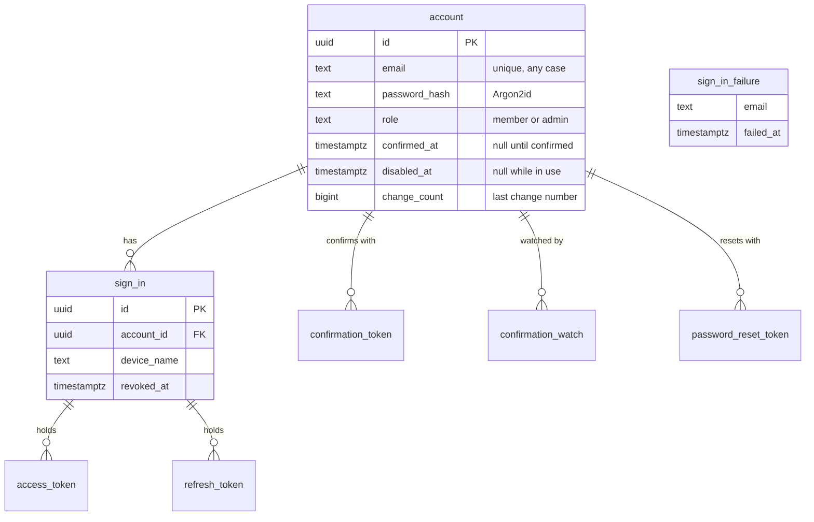
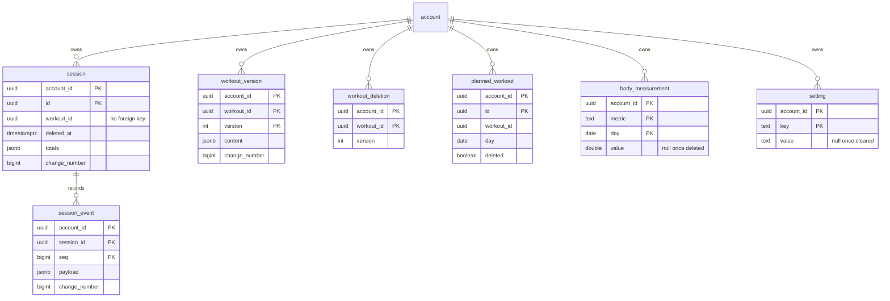
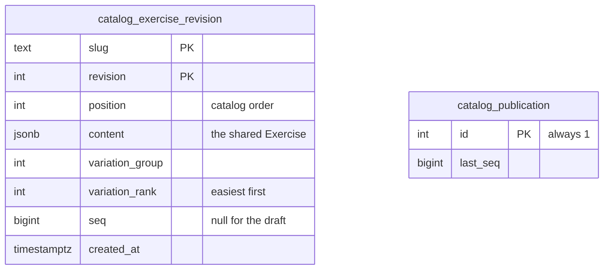

# The server's database

The tables of the server's Postgres database, how they relate, and why they are shaped this way. Read it before changing the schema or writing a query. The phone keeps its own, different database ([the phone's database](#the-phones-database)).

The schema is the numbered migrations in `server/src/main/sqldelight/migrations`, applied on start ([ADR 0022](./adr/0022-the-servers-schema-is-sqldelight-migrations-on-postgres.md)); the typed queries sit beside them in `.sq` files. When this page and a migration disagree, the migration is right.

## How it is shaped

- **Columns for structure, JSONB for content** ([ADR 0007](./adr/0007-postgres-columns-for-structure-jsonb-for-content.md)). What the server filters, sorts or joins on is a column. A workout, a session's events and an exercise are JSONB read with the shared Kotlin types.
- **Everything of a person hangs off `account`.** Deleting an account deletes its rows, except its audit trail.
- **Tokens are stored as SHA-256 hashes**, never as the token, so a leaked table opens nothing.
- **Synced rows carry a `change_number`**, the account's next change count, so a pull after a number never misses a row ([Sync](./sync.md#pull), [ADR 0025](./adr/0025-the-phone-forks-a-conflicting-workout-and-the-server-counts-changes.md)).
- **Nothing is deleted from the sync tables without a trace.** A deletion is a row that says so, so it reaches every phone.

## Accounts and sign-in

An account, its sign-ins (one per phone or browser) and the short-lived secrets that belong to them. The rules a person sees are in [Accounts](./accounts.md).

- `access_token` and `refresh_token` belong to a sign-in, so they live and die together. A refresh token works once and is kept after use, so a second use revokes the whole sign-in ([ADR 0020](./adr/0020-every-credential-resolves-to-one-caller.md)).
- `confirmation_watch` lets a phone waiting on "Check your email" ask whether the link was opened, with a key whose hash is stored.
- `sign_in_failure` has no account column: it counts failed attempts per address, to slow down password guessing.

## Synced data

What a phone pushes and pulls, all owned by an account. Each table keeps the account first in its key, so a person's rows sit together.

Two kinds of table, by how conflicts are settled ([ADR 0006](./adr/0006-sync-keeps-both-edits.md)):

- **Never changed once stored.** `session_event` ([ADR 0003](./adr/0003-sessions-are-append-only-event-logs.md)) and `workout_version`. A push may only add the version that follows the latest; a phone that edited an older one forks a new workout.
- **Latest write wins.** `planned_workout`, `body_measurement` and `setting` keep the write with the latest `changed_at` the phone sent. A deletion is a write: `deleted`, or a null value.

`workout_id` is not a foreign key: a workout is its versions, not a row. `session` and `workout_deletion` also keep a deletion as a row (`deleted_at`, or the deleted version). A newer version pushed after a deletion removes the `workout_deletion` row, so the edit wins.

## The catalog

The exercises phones download, edited and published in the admin ([The catalog's shape](./the-catalog.md), [ADR 0026](./adr/0026-the-server-holds-the-catalog-as-a-draft-and-published-versions.md), [ADR 0030](./adr/0030-the-catalog-changes-by-exercise-revision-not-by-catalog-version.md)). It belongs to no account.

- **One row per revision of one exercise.** A slug has at most one draft revision (no `seq`) and any number of published ones. Published revisions are never changed.
- **`seq` is the publication cursor.** A publish takes the next numbers from `catalog_publication`, under that row's lock, so `seq` follows commit order and a phone asks for what is after the last `seq` it has.
- **The current catalog** is, for each slug, its revision with the highest `seq`.

Tables kept until a cleanup migration

`catalog_version` and `catalog_exercise_revision.published_in` are still in the schema but nothing reads them, now that publications are numbered by `seq`. A later migration drops them ([ADR 0030](./adr/0030-the-catalog-changes-by-exercise-revision-not-by-catalog-version.md), #440).

## Admin and housekeeping

Three tables with no part in the diagrams above.

| Table | What it holds |
|---|---|
| `admin_audit` | One row per admin write: who (`actor_id`, null once that admin's account is deleted), what (`action`), on what (`target`, such as an account id or an exercise slug), and when. See [Admin internals](./admin-internals.md#audit-log). |
| `settings` | Server settings an admin changes without a deploy, one row per name. A setting with no row keeps its default from the environment, and secrets never live here ([Admin internals](./admin-internals.md#settings-and-mail)). Not to be confused with `setting`, the person's synced preferences. |
| `schema_version` | One row: the number of the next migration to apply. Kept by `Database.migrate`. |

## The phone's database

The phone has its own SQLite database in `data/local`, with its own numbered migrations. It is the source of truth ([ADR 0001](./adr/0001-local-first-phone-is-the-source-of-truth.md)) and has no owner column. It holds the same synced kinds (sessions and their events, workout versions, planned workouts, body measurements), the catalog it downloaded, and the sync state: an outbox of changes to push and the cursors of the last pull. Sync moves documents between the two, not tables, so the schemas are free to differ.
