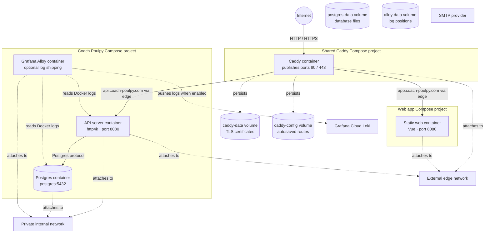

# Deploying the server

The server runs on one Linux machine as Docker containers behind a shared Caddy for HTTPS ([ADR 0019](./adr/0019-the-server-runs-with-docker-compose-on-one-server.md)). Health data must stay in the EU or Switzerland under the GDPR, so pick a host there. This page covers the machine; cutting a release and setting up the Deploy workflow are in [Releasing](./releasing.md).

## What runs on the machine

- **Caddy** is the only container with public ports (80 and 443). It runs in its own Compose project, so stopping the app leaves HTTPS up, and it routes each hostname to its container.
- **The API server** (http4k on Jetty) serves [the API](./the-api.md) under `/api/v1` and `/health`. It applies its database migrations on start ([ADR 0022](./adr/0022-the-servers-schema-is-sqldelight-migrations-on-postgres.md)), and `/health` answers 503 while Postgres doesn't.
- **Postgres** sits on a private network that only the server reaches.
- **The web app** is a static Vue container on its own hostname ([ADR 0021](./adr/0021-the-landing-site-the-app-and-the-api-have-their-own-hostname.md)).
- **Grafana Alloy** is optional and ships logs to Grafana Cloud ([Logs](#logs)).

The server must run as **one container**. It keeps the phones waiting for a confirmed email in memory, so a second replica would first need those events shared.

<details>
<summary>Containers, networks and volumes</summary>



</details>

## What you need

- Linux with Python 3, Docker Engine and Docker Compose.
- About 1 GB of free memory. The server is capped at 512 MB, and images are built in CI, not on the machine.
- DNS records for the API hostname (`api.coach-poulpy.com`) and the web app hostname (`app.coach-poulpy.com`) pointing at the machine.
- SSH, and ports 80 and 443 open (TCP, plus UDP 443 for HTTP/3).
- If the images on `ghcr.io` are private, log the machine in once with `docker login ghcr.io` and a token that can read packages.

## Deploy

Everything deploys from GitHub with **Actions > Deploy > Run workflow**. You never log in to the machine for it. Setting it up once, and every setting it reads, is in [Deploy the server](./releasing.md#deploy-the-server).

- Settings live in GitHub. The workflow rewrites `~/coach-poulpy/.env` on every run, so a change made on the machine is lost.
- The workflow uploads the Compose and Caddy files, then `~/caddy/deploy.py` starts Caddy if needed, starts the server and Postgres, and adds or replaces only this app's route in Caddy. Other sites on the same Caddy are left alone.
- **What to deploy** `website` deploys the web app to `~/coach-poulpy-web` without restarting the server. It needs `WEB_DOMAIN`.
- Check with `curl https://api.coach-poulpy.com/health` and `curl https://app.coach-poulpy.com/.well-known/assetlinks.json`.

### Traps

- **Never run `docker compose down -v`.** It deletes the volumes, and with them the database.
- `POSTGRES_PASSWORD` only applies when the Postgres volume is first created. Changing it later needs a password change inside Postgres too.
- An HTTPS error is almost always DNS or a blocked port. Look at `cd ~/caddy && docker compose logs caddy`.
- If another Caddy already holds ports 80 and 443, remove that container once before the first deploy.

## Mail

The server sends email over SMTP using `SMTP_HOST`, `SMTP_PORT`, `SMTP_USER`, `SMTP_PASSWORD` and `MAIL_FROM`. Port 465 uses implicit TLS, any other port STARTTLS. Changing provider is a new deploy, not a code change.

**Set `SMTP_HOST` before opening sign-up.** Without it, nobody gets a confirmation link, and the admin's [Status](./admin.md#status) says mail isn't configured. `MAIL_FROM` is only the default sender: an admin can save another in [Settings](./admin.md#settings).

The links in emails point at `WEBSITE_URL`, the web app by default. On Android they open in the app, thanks to `assetlinks.json` built from the signing key. On iPhone they open in the browser until there is an Apple Developer account ([#24](https://github.com/tkint/coach-poulpy/issues/24)).

## Logs

On the machine, `docker compose logs server` only reaches back a short while (3 files of 10 MB). For search and longer retention, the deploy can ship logs to the free tier of [Grafana Cloud](https://grafana.com/products/cloud/) (Loki), in an EU region:

1. Create a free Grafana Cloud stack in an EU region.
2. In the stack's **Loki** details, copy the push URL (`https://logs-prod-XXX.grafana.net/loki/api/v1/push`) and the user ID.
3. Under **Administration > Access policies**, create a policy with the `logs:write` scope only and generate a token from it.
4. Add `LOKI_URL`, `LOKI_USER` (variables) and `LOKI_PASSWORD` (secret, the token) to the `production` environment ([Releasing](./releasing.md#deploy-the-server)), then deploy again.

All three are needed: setting only some stops the deploy. Logs are labelled `app`, `environment` and `service`. In Grafana, **Explore** with `{app="coach-poulpy", service="server"}` shows the server. Alloy needs about 256 MB more memory. To turn shipping off after enabling it, remove the settings and stop Alloy once with `docker compose --profile logs stop alloy`.

Logs leave the machine, so they never hold personal data: no secrets, and emails only masked.

## Backups

Dump Postgres nightly, and before deploying a release with new migrations, since an older server refuses a migrated database. Keep the dumps off the machine, in the EU or Switzerland:

```sh
mkdir -p ~/backups
cd ~/coach-poulpy
docker compose exec -T postgres pg_dump -U coachpoulpy -Fc coachpoulpy > ~/backups/coachpoulpy-$(date +%F).dump
```

Restore with `pg_restore -U coachpoulpy -d coachpoulpy --clean`, through `docker compose exec -T postgres`. Back up `.env` and the Caddy configuration too. Losing Caddy's certificate volume only means issuing new certificates.
