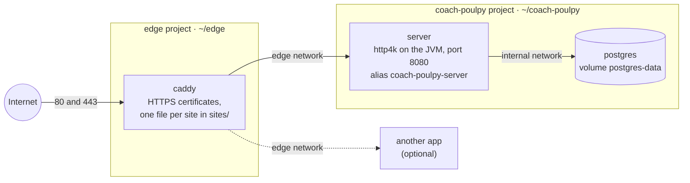

# Deploying the server

The server runs on one Linux machine as Docker containers. Caddy in front serves it over HTTPS. Health data must stay in the EU or Switzerland under the GDPR, so pick a host there ([architecture](./architecture.md#accounts-and-security)).

The server is still a placeholder that answers `/health`. Postgres is deployed beside it but stays empty until accounts arrive ([#25](https://github.com/tkint/coach-poulpy/issues/25)). Why this host and this setup: [ADR 0019](./adr/0019-the-server-runs-with-docker-compose-on-one-server.md). The files are in [`deploy/`](https://github.com/tkint/coach-poulpy/tree/main/deploy), and the image is built from [`server/Dockerfile`](https://github.com/tkint/coach-poulpy/blob/main/server/Dockerfile). Each release publishes both ([Releasing](./releasing.md#the-server)).

## The containers



- **caddy** is the only container that publishes ports (80 and 443). It reads one file per site, so each app on the machine brings its own.
- **server** publishes no ports. It joins two networks: `edge`, shared with Caddy, and `internal`, private to Coach Poulpy.
- **postgres** is on `internal` only. Caddy and other apps can't reach it, and its port is never opened on the machine.
- **The edge network** is created once by hand and belongs to no project. Restarting or removing one project never cuts the others off.
- **Every app's containers share the edge network,** so a plain service name like `server` could clash with another app's. Caddy reaches the server by its own alias, `coach-poulpy-server`.

## What you need

- A Linux machine with Docker Engine and the Compose plugin (`docker compose version`).
- About 1 GB of free memory: the server is capped at 512 MB and Postgres needs a little more. The image is built in CI, never on the machine.
- A domain for the API, such as `api.example.com`, whose DNS A (and AAAA) record points to the machine.
- Ports 80 and 443 open (TCP, plus UDP 443 for HTTP/3), and SSH.

## 1. Get the files

Each release has a `coach-poulpy-deploy.tar.gz` with the Compose and Caddy files. Unpack the one from the [Releases](https://github.com/tkint/coach-poulpy/releases) page (here `v0.3.0`) into `~/coach-poulpy`:

```sh
mkdir -p ~/coach-poulpy && cd ~/coach-poulpy
curl -fsSL https://github.com/tkint/coach-poulpy/releases/download/v0.3.0/coach-poulpy-deploy.tar.gz | tar xz --strip-components=1
cp .env.example .env && chmod 600 .env
# Set POSTGRES_PASSWORD in .env, e.g. to the output of: openssl rand -hex 24
```

The image, `ghcr.io/tkint/coach-poulpy-server`, is pulled from the GitHub Container Registry when Coach Poulpy starts. If the package is private, log in once with a token that can read packages: `docker login ghcr.io`.

## 2. Give it a Caddy

Follow one of the two cases below, depending on whether a Caddy already runs on the machine. Both need the edge network, created once per machine:

```sh
docker network create edge
```

### No Caddy on the machine yet

Set up the edge from the bundle's `edge` folder. It lives in its own folder, so updating Coach Poulpy never touches it:

```sh
cp -r ~/coach-poulpy/edge ~/edge
cp ~/coach-poulpy/coach-poulpy.caddy ~/edge/sites/
# In ~/edge/sites/coach-poulpy.caddy, replace api.coachpoulpy.example with your domain.
# Optionally, set an email in ~/edge/Caddyfile for certificate expiry notices.
cd ~/edge && docker compose up -d
```

### A Caddy already runs

Reuse it rather than starting a second one: two Caddies can't both have ports 80 and 443.

**If it runs in Docker** (in another app's compose project):

1. In that project's `compose.yaml`, attach Caddy to the edge network and mount a sites folder. Keep its existing networks, or it loses its own app:

   ```yaml
   services:
     caddy:
       # ...what is already there...
       volumes:
         # ...the existing volumes...
         - ./sites:/etc/caddy/sites:ro
       networks: [default, edge]

   networks:
     edge:
       external: true
   ```

2. Add this line at the end of its Caddyfile:

   ```text
   import /etc/caddy/sites/*.caddy
   ```

3. Create the `sites` folder, copy `~/coach-poulpy/coach-poulpy.caddy` into it and set your domain. Then recreate Caddy so it joins the network: `docker compose up -d caddy`.

To add or change a site later, edit its file in `sites/`, then reload Caddy with no downtime:

```sh
docker compose exec caddy caddy reload --config /etc/caddy/Caddyfile
```

**If it is installed on the machine itself** (a system package, not a container), it can't resolve container names. Publish the server on the loopback address only, in `~/coach-poulpy/compose.override.yaml`:

```yaml
services:
  server:
    ports: ["127.0.0.1:8080:8080"]
```

Then add the site to that Caddy's configuration with `reverse_proxy 127.0.0.1:8080` and reload it (`systemctl reload caddy`).

## 3. Start Coach Poulpy and check it

```sh
cd ~/coach-poulpy && docker compose up -d
docker compose ps                      # server and postgres show "healthy"
curl https://api.example.com/health    # prints: ok
```

Caddy gets the HTTPS certificate on the first request. If that fails, the DNS record or ports 80 and 443 are usually the cause: `docker logs edge-caddy-1` says which.

## Make an existing Caddy the edge

A Caddy that lives in another app's compose project goes down whenever that app is updated or removed, taking Coach Poulpy with it. Moving it to its own edge project makes it independent of every app. The swap takes a few seconds of downtime, and the certificates are kept.

1. **Prepare the edge.** Create the network (`docker network create edge`) and copy `~/coach-poulpy/edge` to `~/edge`.
2. **Move the sites.** Put each site block from the old Caddyfile in its own file in `~/edge/sites/`, such as `other-app.caddy`, and add `coach-poulpy.caddy`. Replace every `{$VARIABLE}` placeholder with its value, since the edge doesn't have the old project's environment.
3. **Give each app a unique name on the edge network.** In the other app's `compose.yaml`, attach the service Caddy proxied to and give it an alias, then point its site file at the alias (`reverse_proxy other-app:8000` instead of `app:8000`):

   ```yaml
   services:
     app:
       networks:
         default:
         edge:
           aliases: [other-app]

   networks:
     edge:
       external: true
   ```

4. **Keep the certificates.** Find the old Caddy's data volume (`docker volume ls | grep caddy`), then copy it into the edge's volume:

   ```sh
   docker volume create edge_caddy-data
   docker run --rm -v OLD_caddy-data:/from:ro -v edge_caddy-data:/to alpine cp -a /from/. /to/
   ```

5. **Swap.** Remove the `caddy` service from the other app's `compose.yaml`, then run `docker compose up -d --remove-orphans` there. This stops the old Caddy and attaches the app to the edge. Then start the new one with `cd ~/edge && docker compose up -d`.
6. **Check** that every domain still answers. The edge's log (`docker logs edge-caddy-1`) should not mention "obtaining certificate" for the sites that moved.

Once the swap works, delete the old Caddyfile and volume from the other app.

## Updating

Once the Release workflow has published a version, run **Actions > Deploy > Run workflow** on GitHub with `latest` or the version, such as `0.3.0`. It connects over SSH and runs the same commands as by hand:

```sh
cd ~/coach-poulpy
export IMAGE_TAG=0.3.0   # skip to use IMAGE_TAG from .env, normally latest
docker compose pull && docker compose up -d
docker image prune -f
```

Only the server container is replaced: Caddy, Postgres and their data stay as they are. Setting up the workflow's SSH key and secrets: [Releasing](./releasing.md#deploy-the-server). If a release changes the Compose or Caddy files, its notes say so; unpack its bundle over `~/coach-poulpy` again (`.env` is kept, as the bundle only has `.env.example`).

## Backups

Postgres has nothing to back up until accounts arrive, but from then on, dump it every night with cron and copy the dumps off the machine, for example with restic to object storage in the EU or Switzerland:

```sh
cd ~/coach-poulpy
docker compose exec -T postgres pg_dump -U coachpoulpy -Fc coachpoulpy > ~/backups/coachpoulpy-$(date +%F).dump
```

A dump is restored with `pg_restore -U coachpoulpy -d coachpoulpy --clean`, fed in the same way through `docker compose exec -T postgres`. Losing the edge's `caddy-data` volume only means Caddy asks for new certificates.

## Not done yet

- The server doesn't connect to Postgres until accounts arrive ([#25](https://github.com/tkint/coach-poulpy/issues/25)).
