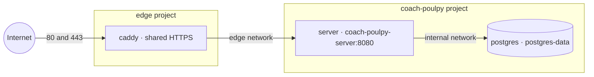

# Deploying the server

The server runs on one Linux machine as Docker containers, behind a shared Caddy for HTTPS. Health data must stay in the EU or Switzerland under the GDPR, so pick a host there ([architecture](./architecture.md#accounts-and-security)). The server answers `/health` with its version and serves [the API](./the-api.md) under `/api/v1`. It connects to Postgres and applies its migrations on start ([ADR 0022](./adr/0022-the-servers-schema-is-sqldelight-migrations-on-postgres.md)); `/health` answers 503 while Postgres doesn't. Postgres holds only the schema's version until accounts arrive ([#25](https://github.com/tkint/coach-poulpy/issues/25)).

The setup follows [ADR 0019](./adr/0019-the-server-runs-with-docker-compose-on-one-server.md). Deployment files are in [`deploy/`](https://github.com/tkint/coach-poulpy/tree/main/deploy), and each [release](./releasing.md#the-server) includes a deployment bundle.

## The containers



Only Caddy publishes ports. The server reaches Postgres at `postgres:5432` with the `POSTGRES_PASSWORD` from `.env`, and starts once Postgres is healthy. The server joins the external `edge` network using a unique alias and the private `internal` network; Postgres joins only `internal`. The app and edge are separate Compose projects, so stopping the app leaves Caddy running. The shared network is for trusted applications: containers on it can reach each other's app ports.

The server runs on Jetty, which holds the phones' server-sent event streams open (Caddy passes them through as they come). It runs as **one container**: who is listening for a confirmed email lives in its memory, so a second replica would need those events shared first.

## What you need

- Linux with Python 3, Docker Engine and Docker Compose.
- About 1 GB of free memory; the server is capped at 512 MB. Images are built in CI, not on the machine.
- An API hostname (`api.coach-poulpy.com`) and a web app hostname (`app.coach-poulpy.com`) whose DNS A/AAAA records point to the machine. The landing site gets its own hostname and container later ([ADR 0021](./adr/0021-the-landing-site-the-app-and-the-api-have-their-own-hostname.md)).
- SSH and ports 80/443 open (TCP, plus UDP 443 for HTTP/3).

If `ghcr.io/tkint/coach-poulpy-server` or `ghcr.io/tkint/coach-poulpy-web` is private (a package's first push makes it private), log the machine in once with a token that can read packages: `docker login ghcr.io`.

## Deploy

Everything is deployed from GitHub; you don't log in to the machine for it. Set up the **Deploy** workflow once ([Releasing](./releasing.md#deploy-the-server)), with `DOMAIN` and `POSTGRES_PASSWORD` in the `production` environment, then run **Actions > Deploy > Run workflow** with `latest` or a version. Check it with `curl https://api.coach-poulpy.com/health`.

The workflow writes `~/coach-poulpy/.env` from those settings (replaced on every run, so change settings in GitHub, not on the machine), uploads `compose.yaml` and the site file to `~/coach-poulpy`, and the shared Caddy to `~/caddy`. On the machine, `~/caddy/deploy.py` then:

- creates the external `edge` network and starts Caddy if needed,
- pulls and starts the server and Postgres,
- adds the site to Caddy through its admin API, or replaces it if already there.

Caddy keeps the configuration it receives through the API in its `caddy-config` volume and resumes it after a restart; `bootstrap.json` is only used before the first site is added. Other sites on the same Caddy are left alone, and deployments wait for each other. To change the hostname, update `DOMAIN` in GitHub and deploy again. Any branch can be deployed by hand to a `preview` environment, beside production or in its place ([Deploy a pull request](./releasing.md#deploy-a-pull-request)). HTTPS errors are usually caused by DNS or blocked ports; inspect `cd ~/caddy && docker compose logs caddy`.

Mail goes out over SMTP to the provider in `SMTP_HOST`, `SMTP_PORT`, `SMTP_USER`, `SMTP_PASSWORD` and `MAIL_FROM`, which the Deploy workflow writes to `.env` from the environment ([Releasing](./releasing.md#deploy-the-server)); changing provider is a new deploy, not a code change. `MAIL_FROM` is only the default sender: an admin can save another from-address in the admin, which wins from the next email on ([the admin area](./admin.md#settings)). Port 465 uses implicit TLS, any other requires STARTTLS. Until `SMTP_HOST` is set, the server prints each email, confirmation link included, to `docker compose logs server` instead of sending it. The links point at `WEBSITE_URL`, the website by default.

`POSTGRES_PASSWORD` only takes effect when the Postgres volume is first created; changing it later needs a password change inside Postgres too.

If another Caddy already holds ports 80/443, remove that container once before the first deploy (`docker rm -f <container>`); the shared Caddy requests the certificates again. Never use `docker compose down -v`: it deletes the volumes.

## The web app

`app.coach-poulpy.com` is a separate container and Caddy route ([ADR 0021](./adr/0021-the-landing-site-the-app-and-the-api-have-their-own-hostname.md)): the Vue app from `web/`, served as static files, with every page path answered by the app. Deploy it with **Actions > Deploy > Run workflow**, **What to deploy** `website`, after setting `WEB_DOMAIN` in the environment ([Releasing](./releasing.md#deploy-the-server)). It lands in `~/coach-poulpy-web` (the server's `APP_NAME` followed by `-web`), from [`deploy/web/`](https://github.com/tkint/coach-poulpy/tree/main/deploy/web), and never restarts the server. Check it with `curl https://app.coach-poulpy.com/.well-known/assetlinks.json`.

The account emails link to `/confirm-email#<token>` and `/reset-password#<token>` there; when a link opens in a browser, those pages confirm the email or set the new password through the API, which accepts browser calls from the origin of `WEBSITE_URL` only. The image carries `/.well-known/assetlinks.json`, built from the Android signing key, so Android opens those links in the app; a build without the key (a deploy with no `ANDROID_KEYSTORE_*` secrets) leaves it out and the links open in the browser. The iPhone's `apple-app-site-association` waits on an Apple Developer account ([#24](https://github.com/tkint/coach-poulpy/issues/24)).

## Logs

Containers log to Docker's `json-file` driver, capped at 3 files of 10 MB each, so on the machine `docker compose logs server` only reaches back a short while. To read them from anywhere, with longer retention and search, the deploy can ship them to the free tier of [Grafana Cloud](https://grafana.com/products/cloud/) (Loki). Pick an EU region when creating the stack, for the same GDPR reason as the host.

1. Create a free Grafana Cloud stack in an EU region.
2. In the stack's **Loki** details, copy the push URL (`https://logs-prod-XXX.grafana.net/loki/api/v1/push`) and the user ID.
3. Under **Administration > Access policies**, create a policy with the `logs:write` scope only and generate a token from it.
4. Add `LOKI_URL`, `LOKI_USER` (variables) and `LOKI_PASSWORD` (secret, the token) to the `production` environment ([Releasing](./releasing.md#deploy-the-server)), then deploy again.

With all three set, the Deploy workflow writes `COMPOSE_PROFILES=logs` to `.env` and an `alloy` container (Grafana Alloy, [`deploy/alloy/config.alloy`](https://github.com/tkint/coach-poulpy/tree/main/deploy/alloy)) starts beside the server. It reads the logs of this Compose project's containers through the read-only Docker socket and pushes them to Loki, labelled `app`, `environment` and `service` (`server` or `postgres`). In Grafana, **Explore** with the Loki data source and `{app="coach-poulpy", service="server"}` shows the server. Setting only some of the three stops the deploy; setting none leaves the logs on the machine. Alloy needs about 256 MB more memory. If you remove the settings after enabling them, stop Alloy once with `docker compose --profile logs stop alloy`.

Logs leave the machine, so they must not hold personal data. The server prints no secrets, and the emails it printed when `SMTP_HOST` was unset are being removed ([#340](https://github.com/tkint/coach-poulpy/issues/340)); until then, set `SMTP_HOST` before enabling log shipping. Check the free tier's limits (monthly volume and retention) on Grafana's pricing page, as they change.

## Backups

Postgres has nothing to back up until accounts arrive. After that, dump it nightly and before deploying a release with new migrations, since an older server refuses a migrated database, and store the dumps off-machine in the EU or Switzerland:

```sh
mkdir -p ~/backups
cd ~/coach-poulpy
docker compose exec -T postgres pg_dump -U coachpoulpy -Fc coachpoulpy > ~/backups/coachpoulpy-$(date +%F).dump
```

Restore with `pg_restore -U coachpoulpy -d coachpoulpy --clean`, fed through `docker compose exec -T postgres`. Back up `.env` and the shared edge's configuration and migration state as well. Losing Caddy's certificate volume requires issuing new certificates.
