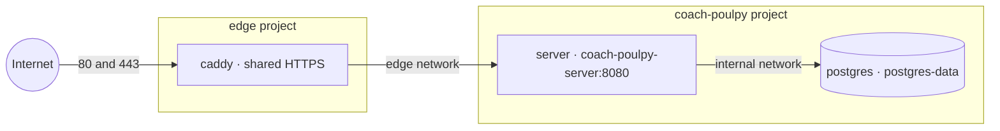

# Deploying the server

The server runs on one Linux machine as Docker containers, behind a shared Caddy for HTTPS. Health data must stay in the EU or Switzerland under the GDPR, so pick a host there ([architecture](./architecture.md#accounts-and-security)). The server currently answers `/health` with its version; Postgres stays empty until accounts arrive ([#25](https://github.com/tkint/coach-poulpy/issues/25)).

The setup follows [ADR 0019](./adr/0019-the-server-runs-with-docker-compose-on-one-server.md). Deployment files are in [`deploy/`](https://github.com/tkint/coach-poulpy/tree/main/deploy), and each [release](./releasing.md#the-server) includes a deployment bundle.

## The containers



Only Caddy publishes ports. The server joins the external `edge` network using a unique alias and the private `internal` network; Postgres joins only `internal`. The app and edge are separate Compose projects, so stopping the app leaves Caddy running. The shared network is for trusted applications: containers on it can reach each other's app ports.

## What you need

- Linux with Python 3, Docker Engine and Docker Compose 2.24.4 or newer.
- About 1 GB of free memory; the server is capped at 512 MB. Images are built in CI, not on the machine.
- An API hostname whose DNS A/AAAA records point to the machine.
- SSH and ports 80/443 open (TCP, plus UDP 443 for HTTP/3).

## 1. Prepare the app settings

Unpack a deployment bundle containing `edge/deploy.py` from the [Releases](https://github.com/tkint/coach-poulpy/releases) page. Replace `vX.Y.Z` with that release's tag:

```sh
mkdir -p ~/coach-poulpy && cd ~/coach-poulpy
curl -fsSL https://github.com/tkint/coach-poulpy/releases/download/vX.Y.Z/coach-poulpy-deploy.tar.gz | tar xz --strip-components=1
cp .env.example .env && chmod 600 .env
```

Set `DOMAIN` to the API hostname without a scheme, port or path. Set `POSTGRES_PASSWORD`, for example to the output of `openssl rand -hex 24`. Keep `.env` and the existing app directory/project name on subsequent deployments.

If `ghcr.io/tkint/coach-poulpy-server` is private, log in once with a token that can read packages: `docker login ghcr.io`.

## 2. Deploy

From the unpacked bundle:

```sh
python3 edge/deploy.py --app-dir . \
  --compose-file compose.yaml --site-file coach-poulpy.caddy
curl https://api.example.com/health
```

From a repository checkout, the equivalent is:

```sh
python3 deploy/edge/deploy.py --app-dir ~/coach-poulpy \
  --compose-file deploy/compose.yaml --site-file deploy/coach-poulpy.caddy
```

The deployer creates the external network if needed, renders this app's `DOMAIN` into its site file, validates the proposed route against Caddy's current config, pulls the images and starts the app and Caddy projects. It handles an absent, running or stopped shared Caddy, with or without the app already deployed.

The shared Caddy lives in `~/edge` by default; `--edge-dir` changes that location. Every deployment sharing Caddy must use the same directory, Compose project and network. `EDGE_NETWORK` defaults to `edge`; custom values must match the edge's network. Do not combine the edge and app Compose files into one project.

Existing site files and a customized edge `Caddyfile` are preserved. Deployment creates or replaces only this app's identified route through Caddy's local admin REST API. Caddy persists accepted API updates to its `/config` volume and resumes that configuration after restart. The admin API stays bound to localhost; deployment calls it from inside the container. A host-level lock serializes independent deployments, preventing concurrent site updates from being lost.

`generated/bootstrap.json` is used only for the first start when no saved Caddy config exists. After that, Caddy runs `caddy run --resume` from its persistent `caddy-config` volume. Do not edit the bootstrap file by hand; change `.env` or the source site template and redeploy. HTTPS errors are usually caused by DNS or blocked ports; inspect `cd ~/edge && docker compose logs caddy`.

## Existing app-owned Caddy

The same deployment automatically migrates a standard Docker Caddy owning host ports 80/443, including a stopped container. Back up application data and configuration first.

Migration adapts the existing `/etc/caddy/Caddyfile` using its original environment, preserves other sites and retains the networks needed by existing upstreams. The named `/data` certificate volume is reused. The new edge uses its own `/config` volume so the previous autosaved config cannot override the bootstrap. Docker aliases are resolved to unique container names so a new service cannot shadow an old upstream.

The legacy config is used only to bootstrap the new Caddy. The hostname being redeployed is removed from the legacy config and recreated through the REST API with a stable `@id`; other legacy routes remain. Legacy networks are detached once no legacy proxy routes remain. The API-autosaved config in `caddy-config`, `migration.compose.json` and the original certificate volume are active deployment state.

The swap briefly interrupts HTTPS. The bootstrap and new route are validated before stopping the old Caddy. If the new edge cannot start, the deployer restores saved edge files and restarts the original Caddy. An application update may already have completed; deployment reports that explicitly rather than claiming a full application rollback.

Ambiguous port owners, non-Caddy containers, custom legacy mounts/config paths and conflicting Caddy settings fail explicitly without stopping the existing proxy. A host-installed Caddy needs explicit manual migration. Never use `docker compose down -v` to clean up a migrated stack.

## Updates

Run **Actions > Deploy > Run workflow** with `latest` or a version. The workflow uploads deployment files from its checked-out ref and selects the app image using the version input. It runs the same deployer, so it also updates this app's Caddy route through the admin REST API and starts Caddy if absent or stopped. SSH settings: [Releasing](./releasing.md#deploy-the-server).

For manual updates, unpack the new bundle in a staging directory and point it at the existing app:

```sh
python3 edge/deploy.py --app-dir ~/coach-poulpy \
  --compose-file compose.yaml --site-file coach-poulpy.caddy --version latest
```

Omit `--version` to use `IMAGE_TAG` from `.env`. Neither deployment path overwrites `.env` or another app's site. Use `--no-pull` only with locally built or preloaded images.

For direct edge inspection after migration, include its override:

```sh
cd ~/edge
docker compose -f compose.yaml -f migration.compose.json ps
```

Omit `-f migration.compose.json` if no migration took place. Also include `-f compose.override.yaml` if the edge is customized; deployment includes both automatically.

## Backups

Postgres has nothing to back up until accounts arrive. After that, dump it nightly and store the dumps off-machine in the EU or Switzerland:

```sh
mkdir -p ~/backups
cd ~/coach-poulpy
docker compose exec -T postgres pg_dump -U coachpoulpy -Fc coachpoulpy > ~/backups/coachpoulpy-$(date +%F).dump
```

Restore with `pg_restore -U coachpoulpy -d coachpoulpy --clean`, fed through `docker compose exec -T postgres`. Back up `.env` and the shared edge's configuration and migration state as well. Losing Caddy's certificate volume requires issuing new certificates.
