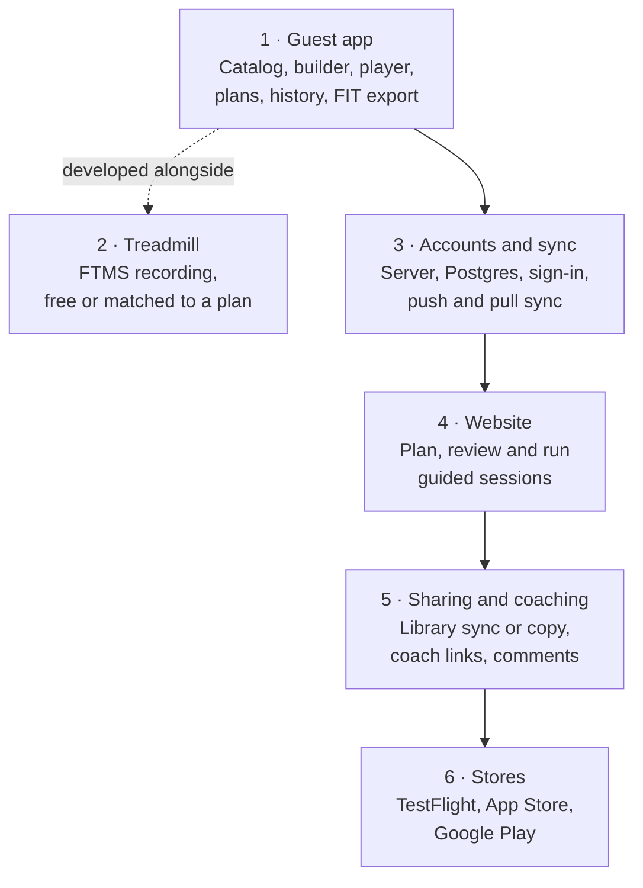

# Roadmap

What ships and in which order. A **phase** is a layer of the product, each added without reworking the one below; a **release** is a set of features inside a phase that makes sense together, cut when it is ready, not on a date.

> **Draft.** The grouping below awaits the maintainer's approval in [#229](https://github.com/tkint/coach-poulpy/issues/229). Release numbers after the current one are not final, and the GitHub milestones still follow the phases until it is decided. The current version is the latest tag on the [Releases](https://github.com/tkint/coach-poulpy/releases) page.

A GitHub release plus the server deployed on Infomaniak is production ([Releasing](./releasing.md)). Publishing in the app stores comes in its own phase, at the end.

## The phases

GitHub milestones follow the phases.

## What v1 includes

| Topic | v1 | Later | Phase |
| --- | --- | --- | --- |
| Audience | The family, as guests or with an account | A public app | 1 |
| Accounts | Guest mode with all data on the phone; email and password, with the guest's data joining the account on sign-up | Sign in with Apple and Google ([#536](https://github.com/tkint/coach-poulpy/issues/536)) | 1, 3 |
| Website | Needs an account; plans, manages, reviews and runs guided sessions without devices | | 4 |
| Catalog | Curated, published from the server and downloaded by the phone, with simple images; no user-created exercises | User-created exercises with duplicate detection | 3 |
| Workouts | Circuit or sets, in parts (warm-up, work, cool down); strength, cardio, rehab, stretching and treadmill walks and runs | Outdoor running, walking, swimming with GPS; workout tags | 1 |
| Treadmill | FTMS read and record, alone or checked against a planned workout | Speed and incline control per phase | 2 |
| Progression | Every week written out by hand | Rules from recognised protocols, driven by sessions and goals | 1 |
| Sharing | Save to library synced with the author or as a copy | | 5 |
| Coaching | Athlete invites a coach and can revoke; coach edits assigned plans and comments on sessions | | 5 |
| Export | .FIT file for Garmin Connect and Strava; optional Apple Health and Health Connect | Direct Garmin and Strava links | 1 |
| Language and units | French and English, metric and imperial: distances, speeds and weights follow the setting (weights are stored in kilograms and shown in pounds in imperial), except a distance picked in whole miles or kilometres, which keeps the unit it was picked in | | 1 |
| Hosting | A GitHub release for the app and the server on Infomaniak, deployed with Docker to one server ([ADR 0019](./adr/0019-the-server-runs-with-docker-compose-on-one-server.md)): this is production | A bigger machine or a managed database when it runs short | 3 |
| Distribution | A GitHub release with the Android APK; iPhone builds from Xcode | App Store, TestFlight and Google Play | 6 |

## Phase 1 · Guest app

Everything the app does for one person, on the phone. Accounts and sync already ship (phase 3), so phase 1 is done when the guest features below are complete on both platforms: **1.0**. Releases 0.6 to 0.10 are out; their contents are in the release notes.

| Release | Theme | Issues |
| --- | --- | --- |
| 0.11 | Home, Library, You | The three-tab bar, the diary Home and Record sheet, the You page, empty states, the Home date picker, [#523](https://github.com/tkint/coach-poulpy/issues/523) Achievements |
| 0.12 | Reuse workouts | [#37](https://github.com/tkint/coach-poulpy/issues/37) swap an exercise for a variation in the builder, [#224](https://github.com/tkint/coach-poulpy/issues/224) a workout from any recorded session, [#511](https://github.com/tkint/coach-poulpy/issues/511) search and filters on the diary |
| 0.13 | Training plans | [#17](https://github.com/tkint/coach-poulpy/issues/17) follow a plan, split into tickets first |
| 0.14 | Beyond the app | [#23](https://github.com/tkint/coach-poulpy/issues/23) Apple Health and Health Connect |
| 1.0 | Phase 1 complete | Whatever remains in the milestone |

Swapping an exercise during a session ([#38](https://github.com/tkint/coach-poulpy/issues/38)) is not planned.

## Phase 2 · Treadmill

Runs alongside phase 1, because the treadmill link was the riskiest piece. What is left is [#14](https://github.com/tkint/coach-poulpy/issues/14), choosing what a device measures from its page, which needs a new design first. Releases are cut with the phase 1 release they fall in.

## Phase 3 · Accounts and sync

Accounts, sync between phones, catalog updates on launch, the admin gate and the account screens ship. What is left:

| Theme | Issues |
| --- | --- |
| Admin catalog workspace | [#26](https://github.com/tkint/coach-poulpy/issues/26) and its open child [#338](https://github.com/tkint/coach-poulpy/issues/338) (drafts, review and publication by revision) |
| Admin | [#381](https://github.com/tkint/coach-poulpy/issues/381) a super admin from environment variables |
| Sign-in | [#536](https://github.com/tkint/coach-poulpy/issues/536) Sign in with Apple and Google |
| Calendar feed | [#241](https://github.com/tkint/coach-poulpy/issues/241) training days as a calendar other services subscribe to |

## Phase 4 · Website

[#29](https://github.com/tkint/coach-poulpy/issues/29) run the shared engine in the browser with Kotlin/JS, then plan, review and run guided sessions.

## Phase 5 · Sharing and coaching

Library sync or copy, coach links and comments. Not broken into issues yet.

## Phase 6 · Stores

Publishing beyond GitHub releases: [#24](https://github.com/tkint/coach-poulpy/issues/24) the Apple Developer membership and TestFlight, then the App Store and Google Play. Until then iPhone builds come from Xcode.

## Later

Wanted, not planned: [#225](https://github.com/tkint/coach-poulpy/issues/225) rethink the workout player and the live recorder as one idea (ADR 0018 stays in force until then), [#30](https://github.com/tkint/coach-poulpy/issues/30) control the treadmill, [#31](https://github.com/tkint/coach-poulpy/issues/31) heart rate straps, [#32](https://github.com/tkint/coach-poulpy/issues/32) user-created exercises, [#33](https://github.com/tkint/coach-poulpy/issues/33) progression rules, [#75](https://github.com/tkint/coach-poulpy/issues/75) guided building of a long run, [#124](https://github.com/tkint/coach-poulpy/issues/124) Poulpy's coaching style, [#228](https://github.com/tkint/coach-poulpy/issues/228) APIs and an MCP server, [#481](https://github.com/tkint/coach-poulpy/issues/481) direct Garmin BLE telemetry.

## Not tied to a release

Documentation work ([#226](https://github.com/tkint/coach-poulpy/issues/226) diagrams, [#227](https://github.com/tkint/coach-poulpy/issues/227) readability) and [#229](https://github.com/tkint/coach-poulpy/issues/229), which defines how releases are planned, go in whichever release is open.
