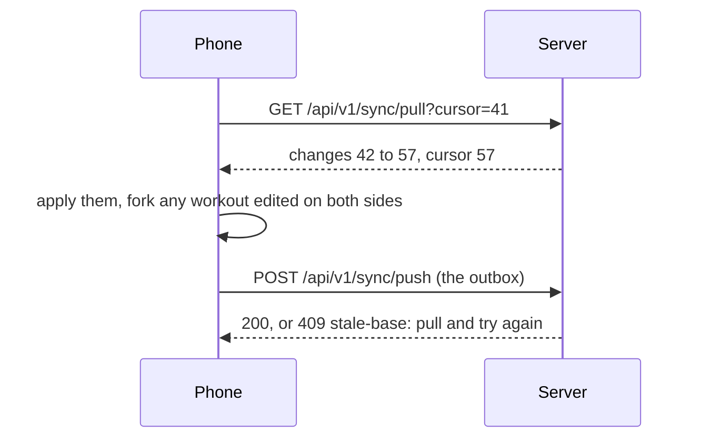

# Sync

How a signed-in phone and the server exchange data, for anyone changing sync code. The rules a person sees are in [Accounts](./accounts.md#what-follows-the-account). Phones sync through the account with two calls, push and pull ([ADR 0006](./adr/0006-sync-keeps-both-edits.md), [ADR 0025](./adr/0025-the-phone-forks-a-conflicting-workout-and-the-server-counts-changes.md)). Both need the `sync` scope, which the apps and the signed-in website hold (the website only reads, through `GET /workouts`; it never pushes).

## When it runs

Only once the email is confirmed, and only while the app is open: when it opens, five seconds after a change, and on pull to refresh. Each run pulls first, then pushes. There is no background sync yet; it would need testing on real phones.

## Pull

`GET /api/v1/sync/pull?cursor=<cursor>&limit=500` answers `{"changes": [...], "cursor": "...", "more": true}`. The phone keeps calling with the new cursor while `more` is true. With no cursor it gets everything, as a phone signing in does.

The cursor is a counter on the account, not a time. Every row the server writes for the account, a deletion included, takes the next number, under a lock on the account row, so two pushes never interleave their numbers and a pull never skips one. The phones' clocks play no part.

A pull also returns the phone's own changes. Applying a change twice changes nothing, so the phone doesn't need to tell them apart. A plan, body measurement, setting or session header whose own change still waits in the outbox keeps the phone's value: the push that follows sends it, and the server keeps the later write.

## Push

`POST /api/v1/sync/push` sends `{"changes": [...]}`, at most 500 changes or 1 MB, oldest first. The phone keeps an outbox: each local write adds its change in the same transaction, and a push that is accepted removes what it carried. The profile, units and language live in the phone's small key-value store rather than its database, so their change is added just after the write instead. Nothing is added while the phone is a guest or its email is unconfirmed.

- **One push is one transaction**: all of it is stored, or none of it.
- **Every change is idempotent**, so a push whose answer was lost is simply sent again.
- **409 `stale-base`** names the workouts whose starting version is out of date. The phone pulls, forks them (below) and pushes again.
- **400 `invalid-change`** gives the index of a change that doesn't parse or breaks a rule. The server checks workout content with the shared Kotlin types ([ADR 0007](./adr/0007-postgres-columns-for-structure-jsonb-for-content.md)). The phone drops that change from its outbox, since it would be refused again and hold back the ones after it.

## How each kind of change merges

| Change | Carries | Merges |
| --- | --- | --- |
| `workout-version` | the `workout` as the shared Kotlin type (its id, `version`, name, format and parts), `baseVersion`, created at | Versions never change once made. The server takes version n + 1 only when its latest is n; the same version again with the same content changes nothing. Anything else is `stale-base`. |
| `workout-deleted` | workout id, the version deleted, when | **The edit wins.** If another phone already pushed a newer version, the delete is ignored and the workout comes back on the phone that deleted it. |
| `session` | the session's header: id, source, workout id and version, start, end, name, format, totals | Only the phone that recorded a session writes it, so the latest push of its header wins. |
| `session-events` | session id, and events with their `seq`, time and payload | A union: an event already stored by `(session id, seq)` is skipped ([ADR 0003](./adr/0003-sessions-are-append-only-event-logs.md)). |
| `session-deleted` | session id, when | Deletes the session and its events on every phone; it can't come back, since nobody else edits it. |
| `planned-workout` | id, workout id, day, created at, when the day was last set | The latest day wins. |
| `planned-workout-deleted` | id, when | The latest write wins, a move or the delete. |
| `body-measurement` | metric, day, value (or none, to delete), when | One per metric and day: the latest write wins, so two phones logging a weight the same day keep the later one. |
| `setting` | key, value (or none), when | The latest write wins per key. The keys are the profile's fields, units and language. Theme, app icon and paired devices aren't synced. |

The latest write is judged by the time the phone gives with the change. A phone with a wrong clock can lose a race on a small field, never a workout or a session.

## A workout edited on two phones

Both phones made version 3 from version 2. The first push wins. The second phone gets `stale-base`, pulls the other version 3, and keeps its own edit as a copy:

1. Its unsent versions of that workout become a new workout, with a new id, at version 1 with the latest of those edits, named after the phone: "Leg day (Ana's iPhone)".
2. Its sessions and planned workouts that pointed at those unsent versions now point at the copy.
3. The outbox is rewritten to push the copy, and the push is sent again.

Both phones then show both workouts, and nothing on the server is rewritten.

## Signing up, signing in and out

- **The first upload** is the whole local database put in the outbox once the email is confirmed, with every id kept ([ADR 0005](./adr/0005-ids-are-uuidv7-made-on-the-device.md)).
- **Signing in on a phone with guest data** pulls everything, then pushes the whole local database the same way. Ids never collide, so this is a union. Same-day body measurements and profile fields keep the latest write.
- **Signing out** with an empty outbox revokes the sign-in, then clears the workouts, sessions, planned workouts, body log, profile, units, language, the outbox and the cursor. With changes still in the outbox, the phone offers to wait or sign out anyway.
- **When the server refuses the refresh token**, the phone becomes a guest again and keeps its data, which happens after a password reset, the account's deletion or a revoked sign-in. Its outbox and cursor are cleared. Signing in again pushes everything once more, and nothing is duplicated.
