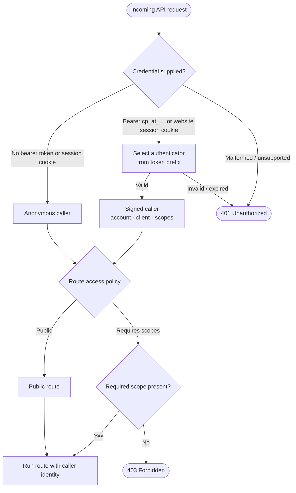
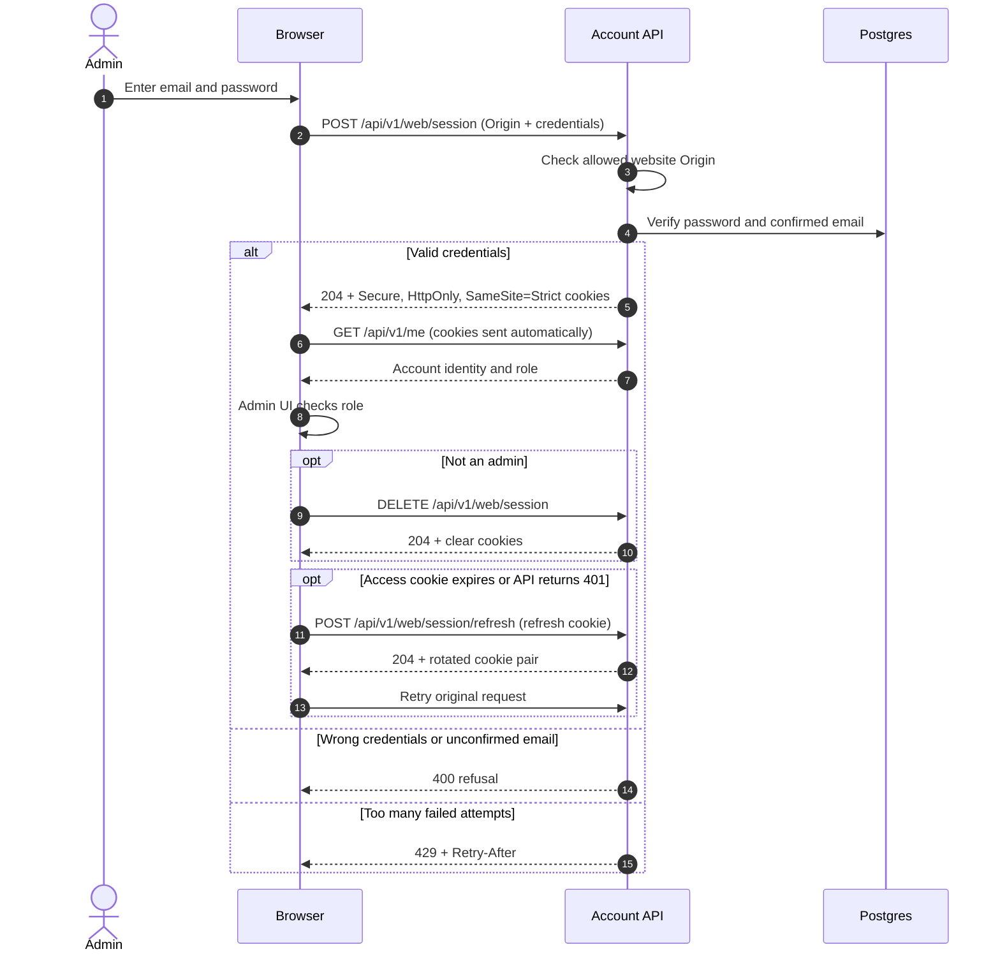

# The API

The server is an API only, at `https://api.coach-poulpy.com/api/v1` ([ADR 0021](./adr/0021-the-landing-site-the-app-and-the-api-have-their-own-hostname.md)). Its routes are described in OpenAPI at `/api/v1/openapi.json`, generated from the code, so that file, not this page, is the full reference. This page says how a request is handled and which routes exist so far.

## How a request is handled

Every request under `/api/v1` passes one filter that finds its **caller** ([ADR 0020](./adr/0020-every-credential-resolves-to-one-caller.md)):



- **A bad credential is never treated as no credential.** An unknown prefix, an expired token or a `Basic` header is a 401, even on a public route.
- **Each kind of token has its own authenticator,** picked by its prefix: `cp_at_` for access tokens, later `cp_pat_` for personal access tokens ([#228](https://github.com/tkint/coach-poulpy/issues/228)). Today only `cp_at_` is registered; a refresh token (`cp_rt_`) is never accepted as an access token.
- **Every route says who may call it.** In the code, each route sets its `security` to `Public` or to `requires(...)` with the scopes it needs; a server test fails when a route sets neither. With no token, `requires` answers 401; with a token missing a scope, 403 with `WWW-Authenticate: Bearer error="insufficient_scope"`. The phone app gets every scope.

## Browser session (admin website)

The browser session uses the same email/password check as the phone, but the server sets secure cookies instead of returning tokens to JavaScript. The current browser sign-in is used by the admin area; a general member sign-up/sign-in experience on the web is not implemented.



The cookies are never readable by page scripts. The website sends them with `credentials: 'include'`; the server checks the website origin on session writes and uses SameSite cookies as an additional CSRF defence.

## Routes

| Route | Who | What it does |
| --- | --- | --- |
| `GET /health` | Anyone | `ok` and the version, or 503 while the database doesn't answer; the Docker health check. Outside `/api/v1`, so it never changes with the API's version. |
| `GET /api/v1/status` | Anyone | `{"status": "up"}`, or 503 `{"status": "down"}` while the database doesn't answer: what the web app's `/status` page shows ([#340](https://github.com/tkint/coach-poulpy/issues/340)). Nothing else, never the version or how the server is configured; the admin's [status](./admin.md#status) has the details. |
| `GET /api/v1/openapi.json` | Anyone | The OpenAPI description of every route below, the OAuth ones included. |
| `GET /api/v1/catalog` | Anyone | The latest published catalog version, in the same JSON the app bundles; the first start publishes the bundled one ([ADR 0026](./adr/0026-the-server-holds-the-catalog-as-a-draft-and-published-versions.md)). With `?newerThan=<version>` it answers 204 when the phone already has that version or a newer one, so phones download it only when it changed ([#27](https://github.com/tkint/coach-poulpy/issues/27)). |
| `POST /api/v1/accounts` | Anyone | Signs up ([#25](https://github.com/tkint/coach-poulpy/issues/25)): `email`, `password` (8 to 256 characters), `language` such as `fr` for the account's emails, and `healthDataConsent`, which must be `true`. Creates an account whose email isn't confirmed and mails it a link valid 24 hours. Answers 202 whether or not the address already has an account, so addresses can't be probed; a 400 carries `{"error": "invalid-email"}`, `invalid-password` or `consent-required`. |
| `POST /api/v1/accounts/confirm` | Anyone | Takes `{"token": …}` from the link, which reads `<website>/confirm-email#<token>`, and confirms the email: 204, or 400 `invalid-token` for a token unknown, used or expired. A token works once. |
| `POST /api/v1/accounts/confirmation-status` | Anyone | Takes `{"key": …}`, the optional `pendingKey` (32 to 128 characters) the phone sent with its sign-up, and answers `{"confirmed": true}` once the link mailed in that sign-up was opened, for 30 days. An unknown or expired key answers `false`, as does one sent for an address already confirmed, so it never tells who has an account. A sign-up with a key of the wrong length gets 400 `invalid-key`. |
| `GET /api/v1/accounts/confirmation-events` | Anyone | The same question as a [server-sent event](https://html.spec.whatwg.org/multipage/server-sent-events.html) stream, with the key in a `Pending-Key` header so it stays out of URLs and logs. Sends one `confirmed` event as soon as the link of that sign-up is opened, at once if it already was, then closes. Otherwise it carries a comment every 20 seconds and closes after 10 minutes, and the phone opens it again. A key under 32 or over 128 characters gets 400. Not in the OpenAPI description, which has no streams. |
| `POST /api/v1/password-resets` | Anyone | A forgotten password: `{"email": …}`. Mails a link, `<website>/reset-password#<token>`, when the address belongs to a confirmed account, at most 3 an hour per account. Always 202, so addresses can't be probed. |
| `POST /api/v1/password-resets/confirm` | Anyone | Takes `{"token": …, "password": …}` and sets the new password: 204, or 400 `invalid-token` (unknown, used or older than 1 hour) or `invalid-password`. Every device of the account is signed out, and the account's other reset links stop working. |
| `POST /oauth/token` | Anyone | The OAuth 2.0 token endpoint ([RFC 6749](https://www.rfc-editor.org/rfc/rfc6749)), with form fields. `grant_type=password` with `username` (the email), `password` and `device_name`, such as `Ana's iPhone`, signs a device in. `grant_type=refresh_token` with `refresh_token` gives new tokens; each refresh token works once, and using one a second time signs that device out, since someone may hold a copy. Answers `access_token` (`cp_at_`, 15 minutes), `token_type`, `expires_in`, `refresh_token` (`cp_rt_`, expires after 90 days unused) and `scope`. A wrong email or password, an unconfirmed email, or a used or expired refresh token get 400 `invalid_grant`; after 5 failures for one email within 15 minutes the password grant answers 429 with `Retry-After`. `client_id` is optional and only `app` is known. |
| `POST /api/v1/web/session` | Anyone, from the website | The website's sign-in: `{"email": …, "password": …}`. Answers 204 and sets two cookies instead of returning tokens, so a script on the page never sees them: `__Host-cp_at` (the access token, 15 minutes) and `__Secure-cp_rt` (the refresh token, only sent to `/api/v1/web/session`), both `Secure`, `HttpOnly` and `SameSite=Strict`. Errors and the 429 limit are the password grant's. The request's `Origin` must be the website's, otherwise 403. |
| `POST /api/v1/web/session/refresh` | Website cookie | Swaps the refresh cookie for a new pair of cookies: 204, or 401 when it is unknown, used or expired (a used one signs the device out, as on the phone). |
| `DELETE /api/v1/web/session` | Website cookie | Signs out: revokes the device and clears both cookies. 204. |
| `POST /oauth/revoke` | Anyone | Token revocation ([RFC 7009](https://www.rfc-editor.org/rfc/rfc7009)): `token`, an access or a refresh token, signs its device out, both tokens included. Always 200, even for an unknown token. |
| `GET /api/v1/me` | Signed in | The `accountId`, `email`, `role`, and the `client` and `scopes` of the token sent ([ADR 0020](./adr/0020-every-credential-resolves-to-one-caller.md)). |
| `DELETE /api/v1/me` | Signed in, the app | Deletes the account at once with every row of it, and signs its devices out. Takes `{"password": …}`, the account's own: 204, or 403 `wrong-password`, or `first-party-only` for a client other than Coach Poulpy's own apps. |
| `POST /api/v1/sync/push` | Signed in, `sync` | The phone's outbox, `{"changes": [...]}`, oldest first: at most 500 changes and 1 MB, stored whole or not at all, and the same changes sent again change nothing ([Accounts, Sync](./accounts.md#sync)). 200, or 400 `invalid-change` with the `index` of the change refused, 409 `stale-base` naming the `workouts` whose version doesn't follow the server's latest (pull, keep the phone's edit as a copy, push again), or 413 `too-large`. Every kind in the Accounts page's table is taken; a `setting` whose key doesn't follow the account (the theme, for one) is `invalid-change`. |
| `GET /api/v1/sync/pull` | Signed in, `sync` | The changes stored after `cursor`, oldest first, at most `limit` (500 at most and by default): `{"changes": [...], "cursor": "57", "more": false}`. Keep calling with the new cursor while `more` is true; no cursor gives everything. A session's header always comes before its events. 400 `invalid-cursor` or `invalid-limit`. |
| `GET /api/v1/workouts` | Signed in, `workouts:read` | The account's workouts, the latest version of each one not deleted, for the website: `{"items": [...], "total", "page", "size"}`. `q` searches the name, the format and the exercises inside in either language, `format` is `circuit` or `sets`, `sort` is `recent` (done last first, never done last) or `name`, and `page` and `size` (1 to 100, 25 by default) cut it into pages. 400 `bad-query` for a value not allowed. `include=text` adds the wording ([Extras](#extras-the-include-parameter)). |
| `GET /api/v1/workouts/{id}` | Signed in, `workouts:read` | One workout: the shared `Workout` JSON of its latest version and its `history` (`timesDone`, `lastDoneAt`, `usualMinutes`). 404 `unknown-workout` when it isn't the account's or was deleted. `include=text` adds its page in words and the muscles it works. |

## Extras: the `include` parameter

Answers carry structured values only (ids, numbers, instants, enums), so a plain API call is never padded with text. A route that can say more takes `include`, with one or several values, comma separated or repeated (`?include=text`), as GitLab's API does. An unknown value is 400 `bad-query`. Today only `text` exists, on the workouts routes: it adds the wording the phone shows (labels, counts, prescriptions, muscles and body map heat) so the website holds no workout wording of its own ([ADR 0027](./adr/0027-the-api-says-the-words-on-request.md)).

The language of `text` is the first one of `Accept-Language` the app has words for (`en`, `fr`), otherwise the account's language. The answer carries `Content-Language` and `Vary: Accept-Language`.

## Trying it locally

```sh
docker compose -f tools/compose.yaml up -d   # the local Postgres
./gradlew :server:run
curl http://localhost:8080/api/v1/openapi.json
curl -i "http://localhost:8080/api/v1/catalog?newerThan=1"
curl -i http://localhost:8080/api/v1/accounts -H 'Content-Type: application/json' \
  -d '{"email":"guest@example.com","password":"correct horse","language":"fr","healthDataConsent":true}'
```

With no `SMTP_HOST`, as on a laptop, no email is sent and none is printed: the confirmation link never leaves the server. Confirm the account in the local Postgres instead, then sign in:

```sh
docker compose -f tools/compose.yaml exec postgres psql -U coachpoulpy   -c "UPDATE account SET confirmed_at = now() WHERE email = 'guest@example.com'"
curl -s http://localhost:8080/oauth/token -d grant_type=password \
  -d username=guest@example.com -d 'password=correct horse' -d device_name=curl
curl -i http://localhost:8080/api/v1/me -H 'Authorization: Bearer cp_at_…'
```

To use the admin locally, confirm your own account that way and start the server with `ADMIN_EMAIL` set to it ([Making the first admin](./admin.md#making-the-first-admin)). Its [Status](./admin.md#status) screen then lists the pending registrations, the accounts still waiting for a confirmation, so you can see who signed up and confirm them the same way. There is no mail catcher. To try real emails, set `SMTP_HOST`, `SMTP_PORT`, `SMTP_USER`, `SMTP_PASSWORD` and `MAIL_FROM` to a mail provider's.
