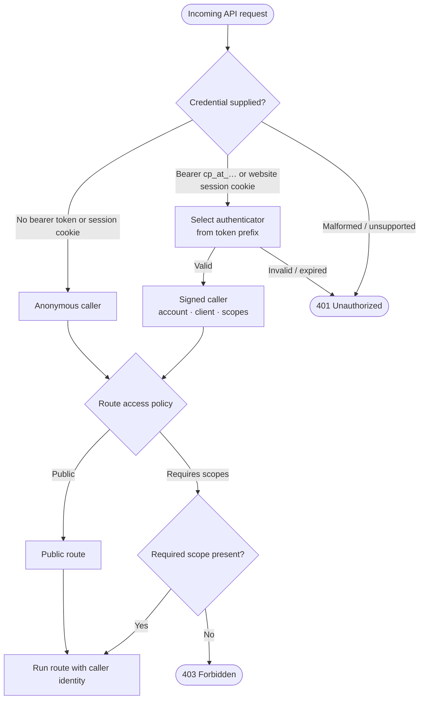
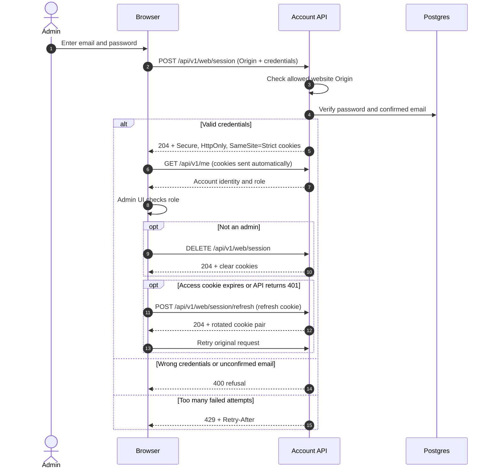

# The API

The server is an API only, at `https://api.coach-poulpy.com/api/v1` ([ADR 0021](./adr/0021-the-landing-site-the-app-and-the-api-have-their-own-hostname.md)). Its routes are described in OpenAPI at `/api/v1/openapi.json`, generated from the code, so that file, not this page, is the full reference. This page explains what OpenAPI can't: how a caller is identified, how signing in works, and how to try the API locally.

## How a request is handled

Every request under `/api/v1` passes one filter that finds its **caller** ([ADR 0020](./adr/0020-every-credential-resolves-to-one-caller.md)):



- **A bad credential is never treated as no credential.** An unknown prefix, an expired token or a `Basic` header is a 401, even on a public route.
- **Each kind of token has its own authenticator,** picked by its prefix: `cp_at_` for access tokens, later `cp_pat_` for personal access tokens ([#228](https://github.com/tkint/coach-poulpy/issues/228)). Today only `cp_at_` is registered; a refresh token (`cp_rt_`) is never accepted as an access token.
- **Every route says who may call it.** In the code, each route sets its `security` to `Public` or to `requires(...)` with the scopes it needs; a server test fails when a route sets neither. With no token, `requires` answers 401; with a token missing a scope, 403 with `WWW-Authenticate: Bearer error="insufficient_scope"`. The phone app gets every scope.

## Signing in

Phones sign in with OAuth 2.0 ([RFC 6749](https://www.rfc-editor.org/rfc/rfc6749)) on `POST /oauth/token`. The website signs in on `POST /api/v1/web/session` and gets the same tokens as cookies.

- **Tokens.** An access token (`cp_at_`) lasts 15 minutes. A refresh token (`cp_rt_`) expires after 90 days unused and works once. Using one a second time signs that device out, since someone may hold a copy.
- **Nothing probes an address.** Sign-up and reset requests answer 202 for every address, and a wrong password, an unknown email and an unconfirmed email all get the same `400 invalid_grant`. Five failures for one email within 15 minutes give 429 with `Retry-After`.
- **Confirmation links** last 24 hours and reset links one hour. Both work once. A reset revokes every device and the account's other reset links.
- **The pending key.** A phone sends a random key (32 to 128 characters) with its sign-up. It's a capability to watch that one sign-up, not an access token, and it never says whether an address has an account. The phone waits on `GET /api/v1/accounts/confirmation-events`, a server-sent event stream with the key in a `Pending-Key` header, and checks `POST …/confirmation-status` on open and after reconnecting. The stream isn't in OpenAPI, which has no streams.
- **Website cookies** are `__Host-cp_at` and `__Secure-cp_rt`, both `Secure`, `HttpOnly` and `SameSite=Strict`, so page scripts never see them. The page calls with `credentials: 'include'`. The server checks the website's `Origin` on session writes, with SameSite as a second CSRF defence. Only the admin uses the website sign-in today.

<details>
<summary>Sign-up and email confirmation</summary>

```mermaid
sequenceDiagram
    autonumber
    actor Person
    participant App as Mobile app
    participant API as Account API
    participant DB as Postgres
    participant Mail as SMTP provider
    participant Browser as Browser / email link

    Person->>App: Submit email, password and health-data consent
    App->>App: Generate pending key; keep pending credentials securely
    App->>API: POST /api/v1/accounts (pendingKey)
    API->>DB: Create unconfirmed account and confirmation watch
    API->>Mail: Send /confirm-email#token link
    API-->>App: 202 Accepted (same for existing addresses)
    App->>API: POST /api/v1/accounts/confirmation-status
    API-->>App: confirmed = false
    App->>API: GET /api/v1/accounts/confirmation-events (Pending-Key header)
    Person->>Browser: Open confirmation email link
    Browser->>API: POST /api/v1/accounts/confirm (token)
    API->>DB: Consume one-time token; mark email confirmed
    API-->>Browser: 204 No Content
    API-->>App: confirmed event on matching SSE stream
    App->>API: POST /api/v1/accounts/confirmation-status (after event / reconnect)
    API-->>App: confirmed = true
    App->>API: POST /oauth/token (password grant)
    API->>DB: Verify confirmed account and password
    API-->>App: Access + refresh tokens
    App->>App: Store tokens in Keychain / Android Keystore
    App->>API: GET /api/v1/sync/pull, then POST /api/v1/sync/push
    API-->>App: Account data and accepted guest data
```

</details>

<details>
<summary>Sign-in and token refresh on the phone</summary>

```mermaid
sequenceDiagram
    autonumber
    actor Person
    participant App as Mobile app
    participant API as OAuth / account API
    participant DB as Postgres

    Person->>App: Enter email and password
    App->>API: POST /oauth/token (grant_type=password, device_name)
    API->>DB: Verify password and confirmed email
    alt Credentials valid and email confirmed
        API-->>App: 200 access token (15 min) + refresh token
        App->>App: Store tokens in Keychain / Android Keystore
        opt Phone contains guest data
            App->>API: GET /sync/pull
            API-->>App: Account changes
            App->>API: POST /sync/push (local outbox)
            API-->>App: 200; guest data joins account
        end
        opt Access token expires soon or request gets 401
            App->>API: POST /oauth/token (grant_type=refresh_token)
            API->>DB: Consume current refresh token
            API-->>App: New access + refresh token pair
            App->>App: Replace stored token pair
        end
    else Wrong password, unknown account or unconfirmed email
        API-->>App: 400 invalid_grant (same refusal)
    else Five failed attempts in 15 minutes
        API-->>App: 429 with Retry-After
    end
```

</details>

<details>
<summary>Password reset</summary>

```mermaid
sequenceDiagram
    autonumber
    actor Person
    participant App as Mobile app
    participant API as Account API
    participant DB as Postgres
    participant Mail as SMTP provider
    participant Link as Browser or app link handler

    Person->>App: Request password reset for email
    App->>API: POST /api/v1/password-resets
    API->>DB: Find confirmed account; enforce 3 links/hour
    API->>Mail: Send /reset-password#token (only if eligible)
    API-->>App: 202 Accepted for every address
    Person->>Link: Open reset link and enter new password
    Link->>API: POST /api/v1/password-resets/confirm (token, password)
    API->>DB: Consume one-hour token; update password; revoke all device tokens
    API-->>Link: 204 No Content
    Note over App,API: All existing sessions are revoked; each client signs out when refresh is refused
```

</details>

<details>
<summary>Website sign-in</summary>



</details>

## Routes

Each route's request, answers and errors are in the OpenAPI document. This is the map.

| Area | Routes | Who |
| --- | --- | --- |
| Health | `GET /health` (outside `/api/v1`, for Docker), `GET /api/v1/status` (up or down, nothing else) | Anyone |
| Catalog | `GET /api/v1/catalog/exercises?after=<cursor>`, the exercises published since the phone's last update ([ADR 0030](./adr/0030-the-catalog-changes-by-exercise-revision-not-by-catalog-version.md)) | Anyone |
| Accounts | `POST /api/v1/accounts`, `…/accounts/confirm`, `…/accounts/confirmation-status`, `…/accounts/confirmation-events`, `…/password-resets`, `…/password-resets/confirm` | Anyone |
| Sign-in | `POST /oauth/token`, `POST /oauth/revoke` ([RFC 7009](https://www.rfc-editor.org/rfc/rfc7009)), `POST`/`DELETE /api/v1/web/session`, `POST …/web/session/refresh` | Anyone, or the website cookie |
| Me | `GET /api/v1/me`, `DELETE /api/v1/me` (needs the password, first-party apps only) | Signed in |
| Sync | `GET /api/v1/sync/pull`, `POST /api/v1/sync/push` ([Sync](./sync.md)) | Signed in, `sync` |
| Workouts | `GET /api/v1/workouts`, `GET /api/v1/workouts/{id}`, read-only for the website | Signed in, `workouts:read` |
| Admin | under `/api/v1/admin/` ([Admin internals](./admin-internals.md)) | An admin on the website |

## Extras: the `include` parameter

Answers carry structured values only (ids, numbers, instants, enums), so a plain API call is never padded with text. A route that can say more takes `include`, with one or several values, comma separated or repeated (`?include=text`), as GitLab's API does. An unknown value is 400 `bad-query`. Today only `text` exists, on the workouts routes: it adds the wording the phone shows (labels, counts, prescriptions, muscles and body map heat) so the website holds no workout wording of its own ([ADR 0027](./adr/0027-the-api-says-the-words-on-request.md)).

The language of `text` is the first one of `Accept-Language` the app has words for (`en`, `fr`), otherwise the account's language. The answer carries `Content-Language` and `Vary: Accept-Language`.

## Trying it locally

```sh
docker compose -f tools/compose.yaml up -d   # the local Postgres
./gradlew :server:run
curl http://localhost:8080/api/v1/openapi.json
curl -i "http://localhost:8080/api/v1/catalog/exercises?after=1"
curl -i http://localhost:8080/api/v1/accounts -H 'Content-Type: application/json' \
  -d '{"email":"guest@example.com","password":"correct horse","language":"fr","healthDataConsent":true}'
```

With no `SMTP_HOST`, as on a laptop, no email is sent and none is printed: the confirmation link never leaves the server. Confirm the account in the local Postgres instead, then sign in:

```sh
docker compose -f tools/compose.yaml exec postgres psql -U coachpoulpy   -c "UPDATE account SET confirmed_at = now() WHERE email = 'guest@example.com'"
curl -s http://localhost:8080/oauth/token -d grant_type=password \
  -d username=guest@example.com -d 'password=correct horse' -d device_name=curl
curl -i http://localhost:8080/api/v1/me -H 'Authorization: Bearer cp_at_…'
```

To use the admin locally, confirm your own account that way and start the server with `ADMIN_EMAIL` set to it ([Making the first admin](./admin.md#making-the-first-admin)). Its [Status](./admin.md#status) screen then lists who is waiting for a confirmation link, and you can confirm them from [Accounts](./admin.md#accounts). There is no mail catcher. To try real emails, set `SMTP_HOST`, `SMTP_PORT`, `SMTP_USER`, `SMTP_PASSWORD` and `MAIL_FROM` to a mail provider's.
