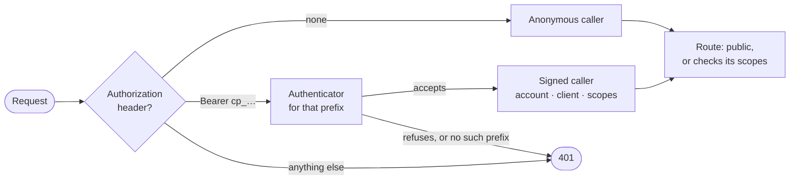

# The API

The server is an API only, at `https://api.coach-poulpy.com/api/v1` ([ADR 0021](./adr/0021-the-landing-site-the-app-and-the-api-have-their-own-hostname.md)). Its routes are described in OpenAPI at `/api/v1/openapi.json`, generated from the code, so that file, not this page, is the full reference. This page says how a request is handled and which routes exist so far.

## How a request is handled

Every request under `/api/v1` passes one filter that finds its **caller** ([ADR 0020](./adr/0020-every-credential-resolves-to-one-caller.md)):



- **A bad credential is never treated as no credential.** An unknown prefix, an expired token or a `Basic` header is a 401, even on a public route.
- **Each kind of token has its own authenticator,** picked by its prefix: `cp_at_` for access tokens, `cp_pat_` for personal access tokens. None is registered until signing in arrives ([#270](https://github.com/tkint/coach-poulpy/issues/270)), so for now every caller is anonymous and every token is refused.
- **Every route says who may call it.** In the code, each route sets its `security` to `Public` or to the scopes it needs; a server test fails when a route sets neither. Scoped routes arrive with accounts.

## Routes

| Route | Who | What it does |
| --- | --- | --- |
| `GET /health` | Anyone | `ok` and the version, or 503 while the database doesn't answer; the Docker health check. Outside `/api/v1`, so it never changes with the API's version. |
| `GET /api/v1/openapi.json` | Anyone | The OpenAPI description of every route below. |
| `GET /api/v1/catalog` | Anyone | The exercise catalog the server was built with, the same JSON the app bundles. With `?newerThan=<version>` it answers 204 when the phone already has that version or a newer one, so phones download it only when it changed ([#27](https://github.com/tkint/coach-poulpy/issues/27)). |
| `POST /api/v1/accounts` | Anyone | Signs up ([#25](https://github.com/tkint/coach-poulpy/issues/25)): `email`, `password` (8 to 256 characters), `language` such as `fr` for the account's emails, and `healthDataConsent`, which must be `true`. Creates an account whose email isn't confirmed and mails it a link valid 24 hours. Answers 202 whether or not the address already has an account, so addresses can't be probed; a 400 carries `{"error": "invalid-email"}`, `invalid-password` or `consent-required`. |
| `POST /api/v1/accounts/confirm` | Anyone | Takes `{"token": …}` from the link, which reads `<website>/confirm-email#<token>`, and confirms the email: 204, or 400 `invalid-token` for a token unknown, used or expired. A token works once. |

## Trying it locally

```sh
docker compose -f tools/compose.yaml up -d   # the local Postgres
./gradlew :server:run
curl http://localhost:8080/api/v1/openapi.json
curl -i "http://localhost:8080/api/v1/catalog?newerThan=1"
curl -i http://localhost:8080/api/v1/accounts -H 'Content-Type: application/json' \
  -d '{"email":"guest@example.com","password":"correct horse","language":"fr","healthDataConsent":true}'
```

With no `SMTP_HOST` set, the server prints each email to its output instead of sending it, link included.
